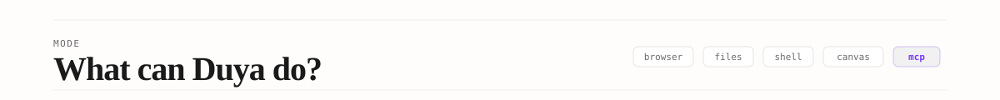
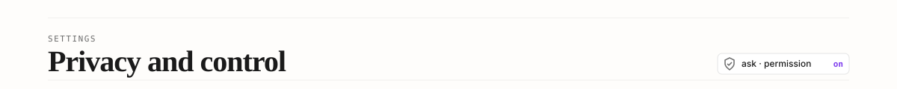
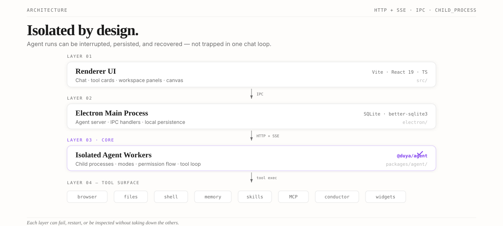

<p align="center">
  
</p>

<h1 align="center">Duya</h1>

<p align="center">
  Open-source, local-first agent infrastructure for Desktop, TUI, and Web — one runtime, multiple ways to work.
</p>

<p align="center">
  <a href="https://github.com/lava-chen/duya/releases">
    
  </a>
  <a href="LICENSE">
    
  </a>
</p>

> **Project status:** Desktop is in public beta. The terminal TUI is under active development, and the Web client is an early-stage, local-only interface. These surfaces share a foundation but do not yet have feature parity.

Duya is an open-source Agent foundation, not just a desktop chat client. The monorepo separates the agent protocol, reasoning and execution engine, Host orchestration, tools, persistence, and client presentation. The goal is to run project-aware agents through different interfaces without rebuilding the agent for each one. Its workspace packages are still under active development and are not currently published as stable public SDKs.

"Local-first" refers to local Host/workspace operation and state, not a guarantee of offline execution. Remote model providers receive the context needed for model requests; browser and connected tools make their own network calls. You can use local Ollama for local inference. The Web BFF listens only on loopback and normally connects to the local standalone Host; it is not a hosted multi-user service.

---

## One task, end to end

Start with one concrete task:

```text
Research how local-first AI agents differ from cloud agents.
Use the browser to collect reliable sources, then create a cited Markdown note in this project.
```

During the run, Duya can:

1. Open and navigate pages in its browser instead of relying only on search snippets.
2. Show browser, file, and terminal activity as tool cards you can inspect.
3. Pause for approval when the selected permission mode requires it.
4. Write the finished note into the project so it remains useful after the chat ends.

You can send a correction or new constraint while the task is still running. Duya will apply it at a safe checkpoint or queue it for the next turn rather than making you restart the session.

---

## One agent foundation, three interfaces

| Interface | Role | Current status |
| --- | --- | --- |
| **Desktop** (`apps/desktop`) | Electron workbench for chat, project files, tool activity, previews, and permissions | Public beta; the most complete user-facing path |
| **TUI** (`packages/cli`) | Terminal chat and CLI control plane using the Host API | Active development; runnable from the repository |
| **Web** (`apps/web`) | Browser client mounting the shared React UI through a local BFF | Early-stage, loopback-only; not a remote deployment |

All three build on a shared set of packages: **Agent Protocol → Agent Core / Runtime → Host → clients**. The Host manages runs, workers, permissions, and event transport; client interfaces present and control that work. Each surface has different maturity and capabilities today.

Duya also exposes extension points through tool capabilities, Skills, MCP, and its evolving plugin system. MCP and plugin configuration is available through the Desktop and CLI control paths; the Web client does not yet provide extension management. Plugin trust and permission controls are not a guarantee of a hardened operating-system sandbox. See [ARCHITECTURE_MAP.md](./ARCHITECTURE_MAP.md) for source-level ownership and [apps/web/README.md](./apps/web/README.md) for Web limitations.

---

## What can Duya do?

The following describes capabilities in the project, primarily exposed through the Desktop workbench. Not every feature is available in TUI and Web yet.



### Research with an interactive browser

Open pages, click controls, type into forms, scroll, manage tabs, take screenshots, and inspect page or network output. This is useful when research requires interacting with a website rather than calling a search API once.

### Read and change project files

Search, read, create, and edit files in the selected workspace. File changes remain ordinary project files, and generated or modified files can be opened from their tool cards.

### Run terminal workflows

Execute shell commands, review their output, and use the result in the next step of a task. The default **Ask** permission mode separates routine reads from actions that require approval; **Auto** and **Bypass** are explicit opt-in modes with warnings.

### Give the agent durable project context

Pin the notes, specifications, agent instructions, and other reference files that should guide the work. Duya uses those references with the current project and session instead of guessing from unrelated files.

### Create and inspect artifacts

Render Markdown, diagrams, charts, dashboards, document previews, and interactive widgets inside the workspace. Keep the explanation in chat while opening the resulting file or visual beside it.

### Extend the tool surface

Install Skills, connect MCP servers, and use plugins to add specialized instructions and tools. These capabilities stay visible in the app rather than becoming an invisible global prompt.

### Organize work on a canvas

Conductor is an experimental project canvas for documents, shapes, tables, links, and agent-created diagrams. It is available for exploratory workflows, but it should not yet be treated as a fully stabilized core path.

---

## Quick start

### Desktop: install the public beta

#### 1. Download a beta build

Get the latest package from [GitHub Releases](https://github.com/lava-chen/duya/releases).

| Platform | Package | Beta status |
| --- | --- | --- |
| Windows x64 | `.exe` installer | Primary packaged test path |
| macOS Intel / Apple silicon | `.dmg` | Available, with less smoke-test coverage |
| Linux | `.AppImage`, `.deb`, or `.rpm` | Available, with less smoke-test coverage |

#### 2. Configure a model

In the provider settings, choose one of these paths:

- Connect a hosted provider or compatible API endpoint and enter its API key.
- Connect local Ollama, which does not require a hosted-model API key.

Duya includes presets for common providers and also accepts compatible custom endpoints. Provider availability, model access, pricing, and data handling remain subject to the provider you choose.

#### 3. Open a project

Choose the folder Duya should work in. This folder becomes the task's project context and default working directory for file search, edits, commands, references, and generated outputs.

#### 4. Run the first task

Use the end-to-end research prompt above. A successful first run should show browser activity in the conversation and produce a Markdown note inside the selected project.

### TUI: run from source

```bash
npm install
npm run build:cli-dev
npm run dev:tui
```

The TUI starts an ephemeral local Host by default. For other CLI commands, see [`packages/cli`](./packages/cli) and the [development guide](./docs/development/README.md). This is a development workflow, not a promise of a separately published CLI package.

### Web: connect to a local Host

The Web client is an early local development surface. The BFF listens on `127.0.0.1` and connects to a running standalone Host; it does not provide remote-user authentication or a hosted deployment. From a fresh checkout, start the Host in one terminal:

```bash
npm install
npm run build:cli-dev
node packages/cli/bundle/cli.cjs serve
```

Then build and start the Web client in another terminal:

```bash
npm run build:web-app
npm run web-app
```

The CLI and Web workspaces are not separately published installable packages. See [apps/web/README.md](./apps/web/README.md) for Host discovery, configuration, and current acceptance-test limitations.

---

## Privacy and control



Duya is designed around a local Host and local persistence, but local-first is not the same as offline or end-to-end encrypted. Exact storage and credential handling vary by surface; the details below primarily describe Desktop.

### What stays on your computer

- Conversation history, session state, tool results, and project references are persisted locally.
- Project files are read and changed in the workspace you selected.
- Provider configuration is stored in Duya's local app-data directory.
- API keys are protected with Electron `safeStorage` when operating-system encryption is available, and Duya requests owner-only permissions for the configuration file on platforms that support them. If `safeStorage` is unavailable, the configuration remains local but should not be treated as encrypted at rest.

### What can leave your computer

- A remote model provider receives the prompts, conversation context, tool results, and file-derived context needed for each model request.
- Browser research contacts the websites you ask Duya to visit.
- Connected MCP servers, plugins, gateways, and other external services follow their own data paths and policies.

Using local Ollama can keep model inference local, but browser requests and any external tools you enable still use the network. Duya's local database and ordinary project files are not end-to-end encrypted by Duya itself, so operating-system account and disk security still matter.

### Permission modes

- **Ask** is the safe default. Routine reads can proceed while writes, edits, commands, or other protected actions can pause for a decision according to the active permission rules.
- **Auto** reduces prompts for approved categories of work.
- **Bypass** grants broad execution authority and should only be enabled when you understand the workspace and task.

Tool calls remain visible in the conversation, and switching to a less restrictive mode requires an explicit confirmation in the UI.

---

## Architecture



Duya's **shared Agent foundation** is independent of any one interface:

- **`@duya/agent-protocol`** defines typed events, run contracts, and wire formats.
- **`@duya/agent-core`** owns pure run reasoning; **`@duya/agent-runtime`** executes agent turns and emits run events.
- **`@duya/host`** owns run orchestration, worker lifecycle, tool registration, and local HTTP/SSE control paths.
- **`@duya/client-core`** provides transport-neutral state models; **`@duya/ui`** provides shared React presentation for Desktop and Web.
- **`apps/desktop`**, **`packages/cli`**, and **`apps/web`** implement the Electron, terminal, and browser entry points respectively.
- Browser, filesystem, shell, MCP, plugin, and other capabilities plug into the Host/runtime stack rather than defining the product boundary.

Agent execution can use child processes with event and permission boundaries. Plugin trust controls and command sandbox options do not provide a universal hardened OS sandbox for every plugin, tool, platform, or configuration.

Core technologies include TypeScript, Node.js, React 19, Electron, SQLite / better-sqlite3, HTTP + SSE, and worker processes. See [ARCHITECTURE.md](./ARCHITECTURE.md) and [ARCHITECTURE_MAP.md](./ARCHITECTURE_MAP.md) for the authoritative package and data-flow details.

---

## Maturity and known limits

Duya is evolving rapidly. The Desktop app is a public beta, while TUI and Web are still being hardened:

- Desktop onboarding, packaged upgrades, and macOS/Linux releases need broader smoke testing.
- TUI runs against a local Host; command support and user experience continue to evolve.
- Web currently binds to `127.0.0.1`, uses a local BFF, and has **no remote-access authentication**. Full worker/browser-chat and refresh-recovery acceptance still need verification.
- Conductor and advanced workspace workflows remain experimental.
- Process separation and permission gates are not equivalent to universal sandbox security.
- Hosted model providers determine their own availability, pricing, and retention policies.

Keep backups for sensitive work and review tool permissions before running an agent.

---

## Development

```bash
npm install
npm run electron:dev   # start Vite and Electron
npm run dev:tui        # terminal UI (run build:cli-dev first)
npm run build:web-app  # build the local Web client
npm run electron:build # build the desktop application
npm run typecheck:all  # type-check every workspace
npm run test           # run unit tests
```

Useful packaging and diagnostic commands:

```bash
npm run electron:pack
npm run electron:verify:packaged
npm run diagnose:env
```

### Repository structure

```text
packages/ui/           Shared renderer (React 19): components, stores, hooks, styles
packages/host/         Product worker: run orchestration, worker supervision, tool registry
packages/agent-*/      Harness core: wire protocol, run reasoning, run engine
packages/capabilities/ Tool implementations: filesystem, shell, browser, MCP
packages/agent/        Legacy shell (retirement in progress)
apps/desktop/          Electron app: main process, preload, renderer shell
apps/web/              Browser client for the standalone Host
packages/cli/           CLI control plane and terminal TUI
packages/client-core/   Shared surface state models
scripts/               Build, bundle, packaging, and diagnostics
docs/                  Architecture, execution plans, and release notes
```

The full package map is in [ARCHITECTURE.md](./ARCHITECTURE.md). For "which
package do I open for this symptom?", see
[ARCHITECTURE_MAP.md](./ARCHITECTURE_MAP.md).

Before contributing, read [AGENTS.md](./AGENTS.md) and check the active work in [docs/exec-plans/README.md](./docs/exec-plans/README.md).

---

## License

[MIT](./LICENSE)
