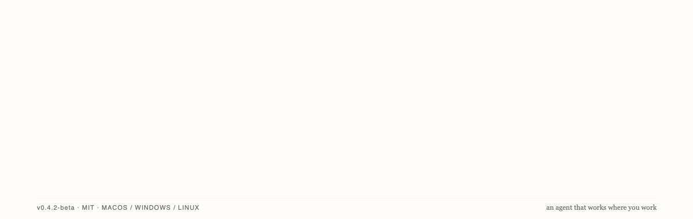

<p align="center">
  
</p>

<h1 align="center">Duya</h1>

<p align="center">
  <strong>一个本地优先、开源、跨 Desktop / TUI / Web 的 AI Agent 基础架构。</strong>
</p>

<p align="center">
  一套共享的 Agent 运行核心，多种交互入口；让工具调用、执行过程与权限决策可见、可控。
</p>

<p align="center">
  <a href="./README.md">English</a> ·
  <a href="https://github.com/lava-chen/duya/releases">下载桌面版</a> ·
  <a href="./ARCHITECTURE_MAP.md">架构导航</a> ·
  <a href="./CONTRIBUTING.md">参与贡献</a>
</p>

> **当前状态：** Desktop 处于公开 beta；TUI 持续开发中；Web 仍是早期的**仅本地访问**版本。三端复用同一套基础能力，但目前**尚未实现功能完全对齐**。

## Duya 是什么

Duya 不再仅仅是一个 Electron 桌面 AI 助手。它是一个以**共享运行时和本地 Host** 为中心的开源 Agent 项目：将协议、Agent 推理与执行、任务编排、工具能力、状态持久化和用户界面拆分成独立的模块，使不同交互入口能够复用同一套运行基础。

Duya 既提供可以直接使用的产品界面，也提供便于继续开发的模块化架构。当前的目标是稳定本地 Agent 执行、可观察性、权限控制与扩展机制；不要将仓库中尚在研发的模块误认为已经公开发布、具有稳定 API 的通用 SDK。

## 一套核心，三种入口

| 入口 | 定位 | 当前成熟度 |
| --- | --- | --- |
| **Desktop**（`apps/desktop`） | Electron 工作台：对话、项目、文件、工具记录、预览和权限交互 | 公开 beta，用户功能最完整 |
| **TUI**（`packages/cli`） | 终端交互界面及 CLI 控制面，通过 Host API 操作 Agent | 源码可运行，持续迭代 |
| **Web**（`apps/web`） | 通过本地 BFF 连接独立 Host，复用 React UI 的浏览器客户端 | 早期实现，仅 `127.0.0.1`，不支持直接作为远程多用户服务部署 |

**关键设计：** Agent 不依附于某个 UI。Desktop、TUI、Web 是不同客户端；Host 管理 run、worker、权限与事件；Agent Runtime 负责执行；协议包定义跨边界的数据契约。各端能力和验收进度仍可能不同。

## 现有能力

以下能力主要通过 Desktop 工作台呈现，不能理解为三端均已完整支持。

- **面向项目的 Agent：** 在指定工作区中读取、搜索、修改文件，运行终端命令，保留任务上下文。
- **工具执行可观察：** 通过工具记录查看浏览器、文件和命令执行过程；敏感操作受权限模式约束。
- **浏览器与研究：** 通过浏览器工具打开页面、交互、截屏，并将结果写回项目。
- **模型可配置：** 可连接远程模型服务或兼容接口，也可使用本地 Ollama。远程请求会将所需上下文发送给对应服务商。
- **扩展能力：** 通过工具模块、Skills、MCP 和仍在发展的插件体系接入更多功能。MCP 与插件配置目前主要通过 Desktop 和 CLI 控制面完成；Web 尚未提供扩展管理界面。插件信任级别和权限控制不等同于操作系统级的安全沙箱。
- **会话与产物：** 本地持久化执行记录、项目上下文和输出；部分文档预览、可视化与 Conductor 画布仍属实验性工作流。

## 快速开始

### Desktop：使用公开 beta

前往 [GitHub Releases](https://github.com/lava-chen/duya/releases) 获取桌面安装包。主要打包目标包括 Windows `.exe`、macOS `.dmg` 与 Linux 安装格式；其中 Windows 测试覆盖更充分。

打开 Duya 后配置模型服务商、选择项目文件夹，即可开始研究、文件或编程任务。例如：

```text
研究本地优先 AI Agent 与云端 Agent 的区别。
使用浏览器收集资料，并在当前项目中生成一份附带来源的 Markdown 笔记。
```

### TUI：从源码运行

```bash
npm install
npm run build:cli-dev
npm run dev:tui
```

`duya tui` 默认启动一个临时的本地 Host，也可以按开发配置连接已有 Host。这是仓库内的开发使用路径，不代表 CLI 已作为独立公共软件包发布。

### Web：连接本地 Host

Web 仍是早期的本地开发入口：BFF 只监听 `127.0.0.1` 并连接独立 Host，不提供公网访问认证或托管部署。全新检出时，先在一个终端构建并启动 Host：

```bash
npm install
npm run build:cli-dev
node packages/cli/bundle/cli.cjs serve
```

再在另一个终端构建并启动 Web 客户端：

```bash
npm run build:web-app
npm run web-app
```

CLI 和 Web workspace 目前不是单独发布、可通过包管理器安装的软件包。浏览器入口通过本地 BFF 与 Host 通信。详细限制与连接方式参见 [apps/web/README.md](./apps/web/README.md)。

## 架构

```text
Desktop (Electron)      TUI / CLI        Web (local BFF + React UI)
         \                 |                 /
                    Host / HTTP + SSE
                           |
              Agent Runtime / Agent Core
                           |
                     Agent Protocol
                           |
           Tools / Skills / MCP / Plugins
```

上图表示各入口共享的逻辑组成，并非所有包的严格调用依赖顺序。

- `@duya/agent-protocol`：类型化事件、run 契约与传输格式。
- `@duya/agent-core`：纯推理决策；`@duya/agent-runtime`：执行引擎、事件与工具调用。
- `@duya/host`：任务编排、worker 生命周期、工具注册、HTTP 控制面及事件分发。
- `@duya/client-core`：与传输方式无关的状态模型；`@duya/ui`：Desktop 和 Web 共用的 React 界面。
- `@duya/cli`：命令行控制面及 TUI；`apps/desktop`、`apps/web`：产品入口。

详细职责与执行链以 [ARCHITECTURE.md](./ARCHITECTURE.md) 和 [ARCHITECTURE_MAP.md](./ARCHITECTURE_MAP.md) 为准。

## 本地优先与安全边界

Duya 以本地 Host、本地工作区和本地持久化为核心，但**本地优先不等于完全离线或端到端加密**。使用远程模型时，请求所需的提示词、消息与项目上下文会发往所选服务商；浏览器工具及外部 MCP/插件也可能访问网络。桌面端凭据保护依赖操作系统可用的加密能力，不能据此假设所有环境中的数据均已加密。

权限提示、进程分离和工具隔离有助于控制风险，但不是对所有平台、配置或插件提供的完整操作系统沙箱保证。Web 目前仅开放本地回环地址；此限制不能代替未来公网部署所需的认证与授权设计。

## 当前限制与开发

- Desktop 已处于公开 beta，首次引导、安装更新及 macOS/Linux 打包仍需更多真实环境验证。
- TUI 与 Web 正在完善功能和端到端验收，不保证与 Desktop 的完整功能对等。
- Web 的完整 worker/浏览器对话与刷新后恢复验收仍需继续推进。
- Conductor 和部分高级工作区流程属于实验功能。

常用开发命令：

```bash
npm install
npm run electron:dev       # Desktop 开发
npm run build:cli-dev      # 构建终端客户端依赖和 bundle
npm run dev:tui            # TUI
npm run build:web-app      # 本地 Web 构建
npm run web-app            # 本地 Web 启动
npm run typecheck:all      # 全仓类型检查
npm run architecture:check # 架构边界检查
npm test                   # 测试
```

仓库主要入口：

```text
packages/agent-protocol/  运行协议与事件契约
packages/agent-core/      纯 Agent 推理逻辑
packages/agent-runtime/   Agent 执行引擎
packages/host/            运行编排、worker 与本地 Host
packages/capabilities/    文件、命令、浏览器、MCP 等工具
packages/client-core/     跨客户端状态模型
packages/ui/              Desktop / Web 共享的 React UI
packages/cli/             CLI 控制面与终端 TUI
apps/desktop/             Electron 桌面端
apps/web/                 本地浏览器客户端
docs/                     设计、开发、执行计划及发布资料
```

贡献前请阅读 [AGENTS.md](./AGENTS.md) 与 [CONTRIBUTING.md](./CONTRIBUTING.md)。Duya 使用 [MIT License](./LICENSE)。
