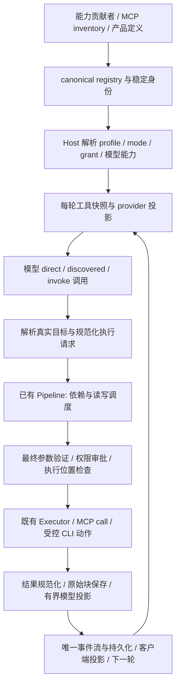

# 工具暴露与 Harness 调用链收敛

状态：active（W0 交付 + F18/F24 修复在 PR 待集成；W1–W10 实施未开始） · 负责人：Codex chat `01a19109-6a8c-7e00-b8b6-90b42e4de19e` · 更新：2026-10-31
分支：`codex/tool-surface-audit` · managed worktree：`D:/codex/worktrees/tool-surface-audit/duya` · 计划起点：`7de85308e4936ea149ead56f51919f9252fb23cd` · 源码审计基线：`a33bbb0542f5effeb8484a64f8ca2cf217272e87`

## 1. 目标与边界

让 agent 在不同模型、worker 和客户端下，都能发现合适的工具、构造正确参数，并通过同一套可追踪的运行契约执行。工具的暴露方式可以变化，权限、依赖调度、取消、工作区隔离、事件持久化和恢复不能因此退化。

用户可观察到的目标：首次工具调用更直接；普通任务不加载大量无关定义；找不到工具时能知道缺能力还是缺连接；同一操作不再同时存在多套容易漂移的入口；新增工具不必同时修改普通 worker、bot、provider、提示词和 UI 的多个硬编码清单。

本计划覆盖基础工具、产品工具、config MCP、App Connector、CLI/skill、provider 投影、工具结果、Harness 执行和客户端呈现。执行代码仍由所属包维护；不新建一套 agent loop、MCP client、权限引擎或注册表，也不在 `packages/agent` 添加新实现。

本轮交付仅为计划。未授权的合并、发布、全量模型付费实验不属于本轮动作；不因为本文列出候选方案，就直接改变用户已有配置或删除工具。

### 1.1 与已有计划的关系

| 计划 | 本计划如何承接 | 避免重复的边界 |
| --- | --- | --- |
| [616 产品能力 MCP](616-duya-app-mcp-layer.md) | 承接产品工具分类、host-owned server、原名权限匹配 | 不再照旧清单迁移 Browser/Computer Use；CLI 可以直接转 skill，不必先迁 MCP 再删除 |
| [617 基础工具接口](617-basic-tool-interface-v2.md) | 复用 schema census、基础工具改进和基准设计 | 基础工具候选在本文排依赖，不另建第二套接口实现 |
| [580 MCP 能力核](580-mcp-capability-core-convergence.md) | 保持 canonical schema、owner replace-set、deadline、结果 blocks、目录生命周期契约 | 不复制 protocol core；旧文档的完成状态须按当前源码与 PR 重核 |
| [Harness 正确性审计](2026-10-24-harness-correctness-audit.md) | 覆盖 request assembly、compaction、provider 边界和事件真实性 | 不把旧审计里的历史缺陷直接当当前缺陷；以当前可复现行为为准 |
| [622 平台收口](622-agent-platform-convergence/README.md) | 新接缝遵守 Host / runtime / protocol / capabilities 依赖方向 | 不借工具改造另起平台重写，不放宽 architecture baseline |
| [外置能力迁移](2026-10-22-external-capability-migration.md) | 保留 Browser、Computer Use 等既定外置方向 | 不重新内置已有外部能力 |
| [产品独立发布](2026-10-29-product-release-separation.md) | CLI skill 迁移必须核验 CLI/Host 版本与打包路径 | 不在本计划直接发布或假定系统 PATH 里的 CLI 与 worker 同版本 |

本计划是跨边界的执行顺序和验收权威，已有专题计划继续保存其实现细节。产生冲突时，在本计划记录明确裁决与对应 PR，不批量重写历史。首个实施 PR 前核对相关计划的当前 head、owner 和独占路径。

### 1.2 路径与责任

当前 owner 仅编辑本计划、索引及必要的引用/接续；没有运行时代码所有权。后续每个切片在自己的 worktree 登记 owner/base/路径后实施。

| 所属包 | 负责 | 不应承担 |
| --- | --- | --- |
| `agent-protocol` / `agent-core` | 线上身份、结果与事件契约；纯决策和验证 | IO、provider SDK、CLI 启动 |
| `agent-runtime` | registry/snapshot、发现、调度、执行管线、权限接缝、事件与终止 | Electron、产品 DB、直接导入 `@duya/ai` |
| `host` | 产品工具装配、profile/mode、可信上下文、manifest、CLI/connector 桥 | 第二套 provider 工具协议或模型循环 |
| `capabilities` / `tooling` | 能力执行与描述、已有 contributor 接口 | 自建 scheduler/agent loop，或从模型参数接收可信 grant |
| `plugin-core` / connectors | MCP 协议纯原语、传输与连接生命周期 | 产品运行的最终授权与终止 |
| `ai` | provider schema/freeform/native-search/result 投影和能力协商 | 决定产品工具权限或工具归属 |
| `cli` / bundled skills | 单一命令解析、JSON 输出、操作指引、版本探测 | 通过 skill 文本授予权限，或复制整份工具解析器 |
| `client-core` / UI / Desktop / Web | 审批、工具身份与结果呈现、事件重放 | 根据显示名推导真实权限或另执行副作用 |

## 2. 已发现的问题与证据等级

源码基线和 Codex 对照见 [工具面审计](../../references/tool-surface-audit.md)。Codex 参照固定为本地 `c7234c1174b27d9c55199fba0d546dc27d1b0415`，不是上游最新保证；session 样本不能代表所有版本、配置和默认工具数。

“已确认”表示当前源码或实际样本能支持；“待复现风险”是设计必须覆盖的场景，不表示已经证明存在漏洞。

| ID | 发现 / 证据 | 影响与处理归属 |
| --- | --- | --- |
| F01 已确认 | [普通 registry](../../../packages/host/src/worker-tools/builtin.ts) 在支持 PowerShell 时展开为 20 eager / 25 deferred，未含 MCP；这不是最终 tools[] | W0 记录最终请求，不能用注册数宣传节省 |
| F02 已确认 | [MCP 配置](../../../packages/host/src/worker-config/tool-exposure.ts) 默认 hint，full/hint 都映射 eager；search 才 deferred | W4 才灰度默认策略，兼容显式配置 |
| F03 已确认 | App Connector 默认 deferred，mention 可提升；与 config MCP 不同 | W1/W4 统一策略解释和诊断，不强行合并 transport/auth |
| F04 已确认 | [可见性过滤](../../../packages/agent-runtime/src/authorization/tool-filter.ts) 的精确 allowlist 会提升 deferred，通配符不会；hidden 不应提升 | W0/W1 纳入有效暴露原因和回归矩阵 |
| F05 已确认 | [catalog](../../../packages/agent-runtime/src/tools/discovery/ToolCatalogTool.ts) 搜索不返回 schema，detail 再读；读取 schema 不提升直接调用 | W3 减少首次发现往返，不破坏可见性守卫 |
| F06 已确认 | [invoke](../../../packages/agent-runtime/src/tools/discovery/dispatcherFromRegistry.ts) 允许已知 ID 直接调用，并按 live schema 校验；不要求每次 detail | W3 同步提示词/错误文案，避免重新引入不必要强制步骤 |
| F07 已确认 | catalog 为加权字符串/标签/同义词匹配；Codex 参照用 BM25 并有 native loadable specs | W3 比较命中率与语种，不直接以 BM25 名称判优 |
| F08 已确认 | [provider 投影](../../../packages/plugin-core/src/mcp/core/projection.ts) 超预算降为空对象；调用点未附已有降级提示 | W2 优先避免无指引参数，canonical 仍保真；当前 size 为 JSON.stringify 长度，不是真正 UTF-8 字节或 token |
| F09 已确认 | [AI deferred 适配](../../../packages/ai/src/utils/deferred-tools.ts) 与 Anthropic `tool_reference` 路径已有条件支持 | W2/W3 核对活链和 provider payload，不能声称“完全没有 native deferred” |
| F10 已确认（W0 修订） | [bot registry](../../../packages/host/src/worker-tools/bot-builtin.ts) 的 eager/hidden 与普通 worker 不同，但 `createBotRegistry`/`registerBotTools` 在生产代码零调用点（仅 legacy shim 转发，shim 亦无调用方）；bot 会话与普通 worker 共用 `createBuiltinRegistry`，bot 差异实际来自 `toAgentProfile` + `applyBotToolset` 的精确 allowlist（[PR #555](https://github.com/lava-chen/duya/pull/555) census 证实） | W1/W4 按有效路径（profile 层）定策略，不按死代码注册表定策略；防止迁移让 bot 失去消息能力或获得交互工具 |
| F11 已确认 | 多项产品能力仍直接 builtin 注册；616 的目标清单不等于已迁移清单 | W5 逐项搬迁验收，复用现有 MCP 和 contributor 接缝 |
| F12 已确认 | [duya_cli](../../../packages/capabilities/src/DuyaCliTool/DuyaCliTool.ts) 重复解析 argv，未知长参数可被跳过，stdout/data 重复 | W6 单一解析器；错误参数显式失败；结果避免重复投影 |
| F13 已确认 | [SessionSearch](../../../packages/capabilities/src/session-search-tool.ts) 含最近会话、scope、排除当前会话、FTS、辅助摘要；[CLI](../../../packages/cli/src/commands/session.ts) 尚不等价 | W6 补 CLI 能力再撤专用入口，不删检索底层 |
| F14 已确认 | 本机已安装 CLI 0.1.0 帮助仍描述标题搜索，不能代表当前源码 | W6/W10 要求配套 CLI 解析和版本验证 |
| F15 已确认 | 普通 worker 同时 eager 提供 write/edit/patch；Codex patch 用 freeform grammar，Duya 为 JSON patch | W7 模型能力配置和 A/B，保留 fallback，不直接删除 patch |
| F16 已确认 | [patch 实现](../../../packages/capabilities/src/ApplyPatchTool/ApplyPatchTool.ts) 部分成功时 error 可为 false；description 同时称 unified diff / Codex patch | W7 显式 partial 和逐文件结果；明确格式，不宣称跨文件事务 |
| F17 已确认 | [pipeline](../../../packages/agent-runtime/src/tools/execution/ToolExecutionPipeline.ts) 以外层 tool.name 查询依赖/读写路径；deferred dispatcher 再解析目标并 execute | W1 必须审计 wrapper 与真实目标的调度一致性；不能仅凭这段代码宣称已确认并发漏洞 |
| F18 已修复待集成 | 审批等待期间 registry/schema/connection/profile/cwd 可能变化；dispatcher 在审批前取得 current，后续有 Host guard/lease。W0 已复现审批窗口绑定缺口（[PR #555](https://github.com/lava-chen/duya/pull/555) 差分套件钉住）；修复见 [PR #558](https://github.com/lava-chen/duya/pull/558)：审批后重解析 live entry（移除→TOOL_NOT_FOUND、exposure/eligibility 变化→具名错误、变更→按 live schema 重校验后以 live executor 执行）+ 决策完成时 structuredClone 绑定执行参数。cwd/执行位置中途变化仍由 Host fence/lease 层负责，MCP executor 自身的 source-approval 为另一路径 | 集成后 I05 审批窗口缺口闭合；W1 剩余：将同等绑定核查推广到直连路径的审批缓存场景（如有），并核对 Host lease 与新错误码的 UI 呈现 |
| F19 待复现风险 | wrapper、MCP、CLI 路径可能丢失真实名称对应的 timeout、hook、取消、快照 metadata 或结果状态 | W1/W8 做差分测试；查明每个字段现有传播情况，不把所有风险写成现存缺陷 |
| F20 已确认 | [文件 contributors](../../../packages/capabilities/src/fs-contributors.ts) 提供描述投影，Host 另建执行实例；已有 [13 槽接口](../../../packages/tooling/src/contributors.ts) | W5/W9 统一描述来源与一致性验证，避免再创建平行扩展框架 |
| F21 待复现风险 | 工具命名/归属变化会影响历史调用、compact、resume、缓存、审批卡与 UI renderer | W8/W10 覆盖兼容，保留原始历史，不用简单全局替换 |
| F22 设计差异 | Codex 支持 direct/deferred 与 code-mode 两轴，按模型能力选 patch/search；Duya 主链是三档暴露和通用 invoke | W2/W3 先做可解释策略和 provider fallback；code mode 作为后置候选，不先照搬六个 enum |
| F23 已确认 | deferred dispatcher 的 outcome 显式转发 result/error/blocks/structured，未通用透传底层 metadata | W8 核对 fileSnapshots、partial 和其他 metadata 的端到端消费者；不凭局部丢字段直接宣称所有恢复均已损坏 |
| F24 已修复待集成 | BOT_TOOLSET（agent-core）写 `SendMessage`，工具注册名是 `send_message`（capabilities SendMessageTool/constants.ts）；精确 allowlist 提升不生效，bot 的发声工具首轮不可见，仅余 catalog/invoke 路径（[PR #555](https://github.com/lava-chen/duya/pull/555) census 钉住）。修复见 [PR #557](https://github.com/lava-chen/duya/pull/557)（BOT_TOOLSET 对齐注册名 + plan 501 delivery 判定双名兼容 replay；permissions GLOBAL_ALWAYS_ALLOWED_TOOLS 的同名漂移属权限语义，留 W4 裁决） | 集成后 bot 首轮直呼 `send_message`；W4 收敛 catalog 依赖前先确认本修复已合并 |
| F25 已确认 | 最终请求出现 `progress_update`，不在 `builtin.ts` 静态注册清单内（装配期动态注入）；census worker-hint 终列 23 个工具与静态 20 eager 不一致即由此而来 | W0 台账给 `progress_update` 记 owner/来源；W9 诊断输出须能解释动态注入 |
| F26 已确认 | 调度分类按外层名：`mcp_*` 直连 READ（并发 5），`tool_invoke` fail-closed SYSTEM（独占串行）——同一目标 hint 下可并发、search 下必串行，方向保守但存在模式悬崖（[PR #555](https://github.com/lava-chen/duya/pull/555) 差分钉住）；取消传播经 wrapper context 到达目标，与直连等价，不合作目标在两条路径同样孤儿化 | W1 差分维持既有结论范围；W3/W4 评估 invoke 串行对 search 模式发现吞吐的影响 |

## 3. 目标调用链与必须保持的 Harness 契约



图中的规范化执行请求是目标接缝，不宣称当前已完整存在，也不要求新建巨型 InvocationService。W1 先在现有 pipeline/ports 上引入最小只读解析结果，再按复现需要抽取共享逻辑。

### 3.1 身份、快照与权限

| 不变量 | 必须证明的行为 |
| --- | --- |
| I01 真实身份 | 区分 provider 可见名、internal key、stable tool ID、owner/source、connection/account 与 schema revision。模型不能提交可信 owner、grant、run ID 或执行 lease |
| I02 调用相关性 | provider call_id 不被替换丢失；wrapper 与目标若有子调用，用显式 parent 关联。审批、日志、UI、结果都能回到同一个模型请求 |
| I03 权威边界 | run 身份与冻结 manifest 仍由 Host 产生；工具投影不自行重算一份配置再自证。目录动态更新采用已有 binding/revision 机制或显式协议增量，不悄悄修改冻结 manifest |
| I04 可见不等于授权 | eager/deferred/native load 只控制暴露；最终目标仍经过 profile/mode/grant/权限与 checkout 写门。hidden 不可被 mention、旧别名或 tool_invoke 复活 |
| I05 执行参数绑定 | 审批对象与执行参数为同一不可变值。等待后若 schema/owner/policy/cwd 变化，按明确错误或重审批处理；不能批准 A 后执行 B |
| I06 并发与依赖 | 调度依据真实目标的 dependencies、read/write paths、并发声明；wrapper 不能把写操作伪装成可并发读。未知元数据采用明确保守策略，而非假定安全 |
| I07 环境隔离 | session cwd/worktree、execution-location fence、write gate、文件快照、子 agent 隔离在 direct/MCP/CLI 路径等价。通用 shell 不是 OS 沙箱，不能声称 skill 能约束任意 shell |
| I08 时间与取消 | 每次调用使用有定义的总 deadline，排队/审批/执行分别可观测；不同阶段耗时规则需明确。取消传递到底层进程或 MCP request，不能为取消单个调用关闭共享连接 |
| I09 生命周期唯一 | 目标副作用只执行一次；每个 provider 调用恰有可关联的结果或明确终止处置。内部路由可有诊断 span，但不能让同一操作重复发 start/complete 或重复计费 |
| I10 事件真相 | 保持唯一 run seq 权威、持久化顺序和 terminal 放行条件；失败/取消/审批暂停不伪造成成功或提前结束。streaming partial arguments 未闭合前不能执行 |
| I11 结果保真 | success/partial/failed/cancelled/timeout/approval-pending 区分；MCP blocks/structuredContent 和文件快照等 metadata 不因 wrapper 丢失。存储保真与模型上下文限量分开 |
| I12 恢复兼容 | replay 只重建显示与状态，不重放副作用。resume/compact/模型切换后重新确认有效工具策略，失效 schema/reference 不能沿用到错误连接 |
| I13 重试边界 | 只读与可证明幂等动作可按策略重试；写调用超时且执行结果未知时，先对账，不盲目重试。RPC error、业务失败、连接故障和工具 timeout 分开 |
| I14 发现安全 | 搜索过滤遵守权限范围，tool metadata 视为数据。schema 校验失败不自动放宽；不可用原因区分“无匹配/无权限/连接失败/目录 stale/被 profile 隐藏”而不泄漏受限工具详情 |
| I15 活上下文 | in-process 产品 MCP 只能从 Host 绑定可信上下文；跨 JSON/进程的 MCP 不可依赖函数对象或模型伪造 `_meta`。CLI 不通过命令行裸传 token 或环境密钥 |
| I16 会话作用域 | pipeline 每轮新建并仅 drain 一次；catalog view、批准记录、已加载 schema 不串 session/run/account。清理不得误删其他会话仍使用的状态 |

### 3.2 直接调用与路由调用的等价标准

同一能力、同一参数、同一授权上下文下，direct、generic invoke、native-loaded、产品 MCP 应产生相同的最终参数验证、权限结论、依赖约束、执行位置、目标结果和终止分类。允许模型外层消息形态与路由诊断不同。CLI 迁移对可映射的产品动作做同样验证；无法保留运行控制语义的动作继续使用 typed 接口。

不能通过给 `tool_invoke` 增加全局 allow、关闭 timeout、清空 dependencies、吞掉 exitCode 或去除 write gate 达到“链路跑通”。也不能让新路由绕开已有 `ToolExecutionPipeline`，再自行创建第二套队列。

## 4. 工具分层与扩展约束

| 层 | 候选能力 | 暴露方向 | 迁移条件 |
| --- | --- | --- | --- |
| 基础工作工具 | 文件读写/搜索、shell、图片读取 | 小而明确；按任务和模型能力选择 | 保留独立语义，先测 edit/patch 组合，不用万能 action 替代 |
| Harness 控制 | 子 agent、提问、后台任务、取消、模式、会话内进度 | typed，按交互/后台角色约束 | CLI/skill 不代替活控制协议；hidden 与非交互约束保持 |
| 产品能力 | 消息、agent/routine 管理、持久计划/记忆、widget/artifact 等 | 复用 `duya_app` 或既有 connector，默认按需 | 每项选择 MCP/CLI/typed 的依据记录在清单，避免一项保留多个常用入口 |
| 外部能力 | 用户配置 MCP、外部插件、远程 app、多账号 | 统一发现和策略解释，传输/鉴权继续按边界隔离 | 名称、owner、account stable；重名不能覆盖 trusted builtin |
| 操作指引 | CLI 使用、专业流程、低频管理操作 | skill 按需加载 | skill 提供指引，不成为权限或 runtime 真相来源 |

新增能力应在一个权威定义里声明身份、描述/schema、来源、默认角色策略、风险/并发/取消语义和执行端口，再由装配投影到不同 surface。字段尽量复用现有 ToolMeta/ToolExecutor/contributor；确需扩展时先写契约和旧工具默认值，禁止新建与 registry 平行的“工具总表”。

扩展的风险/只读/幂等声明只是待验证元数据，外部 MCP 的 annotations 不能直接授予信任或权限。扩展版本、来源与授权变更要能使旧缓存/批准失效；卸载和禁用必须撤销有效调用能力。MCP resources/prompts/tasks/elicitation 的全量实现不纳入本次迁移承诺；如工具依赖其中某项，单列兼容与失败路径，不以本文默认视为已支持。

验收以一个真实低风险扩展示例证明：新增定义和 executor 后，普通 worker、bot 和 catalog 按策略自动获得一致身份；UI 至少有通用 renderer，不要求为每个工具改一个专用分支；未知扩展字段显式降级或拒绝，不能影响 run 生命周期。

### 4.1 具体去留方向

- `duya_cli`：目标为真实 CLI + bundled skill；保留旧会话解码/兼容能力，先撤新会话暴露，再在兼容窗口结束后评估删除实现。没有 shell 的 profile 保留窄 typed adapter，不额外开放通用 shell。
- `SessionSearch`：补 CLI scope、排除当前会话、最近会话、FTS/片段、分页、稳定 ID；默认主 agent 消化片段，辅助摘要变成显式可选，不能隐式增加一次模型调用。底层检索继续存在。
- `session` / `MessageSession`：逐 action 分类；只读管理可走 CLI，唤醒/发送/运行生命周期先保持 typed 并验证投递与授权。避免与 bot `send_message` 等仅凭名字合并。
- `write` / `edit` / `apply_patch`：保留实现；不同模型/任务的默认集合由能力配置和 W7 评测决定，显式用户选择优先。freeform 只在 provider 支持且整条调用链验收后启用，JSON fallback 必须可用。
- `glob` / `grep` / `read`：先提升参数与结果契约、读取预算、分页/截断和失败反馈；是否合并以正确率与往返测量决定，不凭工具数删。
- `bash` / `powershell`：明确平台默认、shell 身份、cwd、PTY/后台 session、stdin、timeout、取消、输出预算和退出码。是否统一工具入口单列兼容评估，不混淆两种语法。
- `todo` 与产品 `plan`：明确会话内进度和持久计划区别，去掉重复提示词；是否收敛状态源先审计消费者与恢复，不直接删除一边。
- `Brief`、`memory_write`、`write_stage1_policy`、`update_state`、`vision`、`image_generate`、`read_module`、`show_widget`、`send_artifact`：W0 逐一登记角色/来源/消费者和重叠能力。没有验收依据的不顺手删，低频能力优先按需暴露。
- `tool_catalog` / `tool_invoke`：通用 fallback 保留；已知 ID 可直接 invoke，未知参数可查 detail。同步描述、guard 错误与 skill，不能一处说可直接调用、另一处强制每次先 detail。
- Browser / Computer Use / 已外置 Canvas：只核验发现和调用兼容，不逆转既有外置方向。

## 5. 阶段与依赖

每个 W 项可以再拆成独立 PR；不要求一次提交整个阶段。共享 registry/pipeline/protocol 变更串行集成，只有契约固定且路径独占后才考虑并行实施；本轮未分派子 agent。

| 阶段 | 优先级 / 依赖 | 交付 | 出口 |
| --- | --- | --- | --- |
| W0 事实与基线 | P0 / 无 | 请求级 census、能力台账、差分场景、首个失败基线 | 能解释一项工具为何出现/消失；有可复跑比较输入 |
| W1 Harness 等价 | P0 / W0 | 真实目标解析接缝与回归，不重写 loop | I01–I16 相关场景通过，阻断型失败有具名结果 |
| W2 Schema/provider | P0 / W0；依赖执行行为时须 W1 | 消除静默空 schema，冻结兼容投影策略 | canonical 不变、provider payload 可验、fallback 正常 |
| W3 发现与加载 | P1 / W1、W2 | 少往返发现、native 能力适配、缓存失效 | generic/native 的授权和结果等价，预算有界 |
| W4 暴露策略 | P1 / W0–W3 | 默认/显式配置/角色/mention 的统一解释 | 普通 worker/bot/子 agent/后台均有有效策略，无失声或越权 |
| W5 产品 MCP 收敛 | P1 / W1–W4、616 基础设施 | 逐能力迁移表与真实 MCP 验收 | 来源权限正确，三端与 L1–L9 验收，无双重副作用 |
| W6 CLI/skill 去重 | P1 / W1、W2、W0；可独立于 W5 的产品批次 | 配套 CLI、检索等价、skill、新会话撤入口 | 打包 worker 真调用通过，Host 授权/审计/取消不丢失 |
| W7 基础工具质量 | P1 / W1、W2；暴露试验依赖 W4 | patch partial 修复、编辑/搜索/shell 改进与 A/B | 正确性先过，模型暴露候选有真实比较结论 |
| W8 历史与结果 | P0 横切 / W1 起；所有破坏性迁移前 | ID/alias、结果规范、恢复与 compaction 兼容 | 旧历史可读、无副作用重放、状态和附件不失真 |
| W9 扩展接入与可诊断性 | P1 / W1–W5 | 定义投影、结构化诊断、扩展示例 | 新能力不新增一串硬编码名单，身份/策略可解释 |
| W10 打包、灰度和退役 | P0 交付门 / 各迁移 W8 完成 | 版本矩阵、灰度开关、回滚、旧入口退役清单 | 全链验收与最新 head review/CI 通过后方可授权集成 |
| W11 Code mode 可行性 | P2 / W0 基线与 W1–W10 稳定后 | 成本收益与沙箱/资源/权限设计裁决 | 只在组合调用收益明确时另开实现切片，否则延期 |

### W0 — 请求级基线与能力台账

- [ ] 从当前检出构建普通 worker、bot、子 agent、workflow/automation/wake/headless；记录客户端入口、provider/model/profile/mode/config 及最终工具清单。
- [ ] census 至少包含：ID/name/source/owner/account、注册暴露/有效暴露及原因、schema revision、canonical/projected 大小、描述长度、真实 UTF-8 字节和可获得时的 token 估计。不得把估计 token 当实际 usage。
- [ ] 使用 config MCP + App Connector + 产品 builtin 各一组样本，覆盖显式 full/hint/search、默认值、mention、精确 allowlist/通配符、hidden、disabled、连接不可用和大 schema。
- [ ] 复用 617 census/benchmark 入口；先核对脚本是否已经存在，再决定补齐。原始基线输出放本地研究目录，版本化仅存去敏 fixture、方法和摘要。
- [ ] 建立成功操作基准与失败场景：发现命中、schema 失败、审批拒绝/暂停、超时、取消、重连/目录更新、compact/resume；保留文件/用例/错误签名。
- [x] 台账逐项注明"保留/按需/CLI/产品 MCP/外部/待决"、消费者、兼容映射和 owner，不留下"其他工具以后再说"的盲区 → [工具面能力台账](../../references/tool-surface-ledger.md)（2026-10-31，基于 PR #555 census；待决项均带核对动作）。

### W1 — 真实目标解析与执行契约

- [ ] 对 direct 与 invoke 画出实际权限、hooks、timeout、依赖提取、执行位置、结果 metadata、事件写入路径，包含 Host adapter 与 runtime dispatcher；区分已经共享与确实重复。
- [ ] 在调度前解析可确定的真实目标，输出最小不可变执行视图：外层 ID、目标身份与参数、revision/source、依赖/读写路径、取消/deadline 策略。解析本身不能执行副作用或批准调用。
- [ ] 延迟目标在最终执行前再次核对可用性、schema/owner 与有效策略；明确审批期间变化的处理。上下文 fence/lease 保留，不将调用时的 cwd 从模型参数当可信来源。
- [ ] 用同一目标分别 direct/invoke 执行差分场景；覆盖同文件读写、两个 wrapper 写操作、一个 wrapper 与一个 direct 冲突、不同文件可并发、无路径信息的外部写操作保守调度。
- [ ] 验证 hook、审批、快照、usage、事件没有重复或漏掉；wrapper span 与目标执行关系清楚。写操作未知结果不得自动重试。
- [ ] 验证 run 取消时排队、审批等待、MCP 调用、CLI 子进程和后台任务的所有权处置；后台继续运行必须是显式转移，不能成为孤儿。
- [ ] 保留每轮 pipeline 的 publish/drain 一次契约。controller 与引擎不能 drain 另一轮实例，不能把 pipeline 缓存为整个会话共用。

### W2 — Schema 与 provider 投影

- [ ] canonical schema 原样进入 revision、catalog detail 和执行校验；provider projection 独立，不能回写污染 canonical。
- [ ] 超预算时优先改为可发现/可查 schema 的有界路径或明确不可用；不能静默发空 schema。若 provider 必须降级，描述、原因和调用方法必须可见，且不可制造与执行校验矛盾的空参数要求。
- [ ] 分别测 canonical JSON 长度、UTF-8 字节、provider 完整请求体与工具总预算；大 description 同样受控，不只盯 input_schema 的单工具 8K。
- [ ] provider 能力矩阵包含 JSON function、custom/freeform grammar、namespace、native tool search/reference、structured result、多模态块；使用已声明能力与实际 payload 测试，不按厂商品牌猜测支持。
- [ ] 覆盖 OpenAI Responses、兼容 Chat Completions、Anthropic 和不支持 reference 的第三方端点；不支持的功能回落 generic catalog/invoke，不能假加载成功。
- [ ] custom/freeform 的原始文本输入、流式拼接、grammar 失败、工具结果配对必须贯通 provider → pipeline → executor；不能仅在 schema 中加 format 就认为完成支持。JSON Schema 的引用、组合与根类型在 canonical 校验和 provider 投影中分别测试。
- [ ] 模型/provider 切换、compact、连接/account 变化时失效 reference/schema cache；工具定义排序稳定，减少无必要的 prompt cache 抖动。

### W3 — 少往返发现

- [ ] 保留 query/detail/namespace list 能力与稳定分页；试验 query 在总预算内附 top-k schema，响应给出 schema 是否完整、revision 和直接/invoke 方法。不得为每个候选附巨型 schema。
- [ ] 比较现有加权匹配与 BM25/混合检索；fixture 覆盖中文、英文、动词、精确名称、连接器名和低频能力。保留 namespace 枚举作为检索漏召回的恢复路径。
- [ ] 统一 catalog、invoke、可见性守卫、提示词和错误文案：detail 可选，已知 ID 合法参数可直接 invoke；失效 ID/schema 提供有界恢复指引，避免无限盲重试。
- [ ] native search 返回的定义与 generic catalog 使用同一 eligible 集合和 owner/revision。已加载工具只能在明确的请求快照内直接调用；不得因为“搜到过”永久获得权限。
- [ ] 生命周期沿用 580：list_changed 原子 replace、失败保留 stale 而非清空、account stable、旧 generation 不覆盖新目录、分页 revision 改变时明确重查。
- [ ] 构建可解释的无结果状态；连接故障不能被投影成“工具不存在”，受限工具信息不越权泄漏。

### W4 — 暴露策略与配置迁移

- [ ] 将配置读取、profile/mode、默认角色、mention promotion、精确 allowlist 与 provider 能力的决策形成可测试的纯策略结果；复用现有 resolver，避免重复 if 分散在多个装配点。
- [ ] 默认 config MCP 从 hint/eager 向 search/deferred 的改变只针对未显式配置者灰度；旧 full/hint/search 保留可理解含义和回滚。不能悄悄改用户 config.toml。
- [ ] 普通 worker、bot、子 agent、automation/workflow/wake 定义角色策略；bot 必要的发送/回复能力不能因搜索收敛而从首轮失去，非交互角色不能获得必须有人点击的工具。
- [ ] 工具开关/profile UI 和实际工具集合使用相同决策数据；关闭 connector 后旧 mention/缓存/精确 allowlist 不能复活它。
- [ ] mode 中途变化时，下一请求与尚未执行的调用采用有定义的切换语义；不得沿用旧曝光视图绕过新权限。

### W5 — 产品 MCP 与定义去重

- [ ] 按 W0 台账逐项裁定 MCP/CLI/typed；现有产品 server 的 server identity、original-name 权限和 source app 路径须先验收。
- [ ] 每批只迁一个领域，避免同时改名字、schema、功能和运行行为。过渡 adapter 不得造成旧 builtin 与 MCP 两条路径重复执行。
- [ ] 保留小而明确的 typed 操作；一个 server 可以有多个工具，不把它压成 `action:any,payload:any`，也不在现有 tool_invoke 外再套通用 invoke。
- [ ] 描述和执行元数据从同一权威定义投影到普通 worker/bot；复用 contributor 接口，核对 description-only projection 与实际 executor 的一致性。
- [ ] 产品工具不借 bundled 来源免审批；校验 app source、真实动作权限和原名/alias 匹配。多账号、重名外部工具、重载和移除均覆盖。
- [ ] 三端真实 worker + MCP conformance L1–L9 通过后再撤对应 builtin 的新会话暴露；Browser/Computer Use 的外置路径单独验收。

### W6 — CLI/skill 迁移

- [ ] CLI descriptors/命令解析作为单一权威；未知 flag、互斥参数、缺参数显式失败。`duya_cli` 过渡实现只能适配同一解析器，不再维护第二套 argv 语法。
- [ ] worker 解析配套 CLI 的绝对路径与版本/协议兼容性；覆盖 Desktop 打包、独立 CLI/TUI、Web Host 和 Windows PowerShell/Git Bash，以及空 PATH、空格/中文路径。
- [ ] CLI action 由 Host 绑定可信调用来源和能力，不接受模型自报的 invokedBy/run/grant。`--yes` 只控制交互确认，不能替代 Host 写权限。token 不进入命令行、提示词和普通日志。
- [ ] 非交互命令提供 JSON、退出码、stderr、分页/输出限制、取消和 timeout；输出失败不返回伪成功 envelope。长 JSON/正文用文件参数或 stdin，避免 shell 转义破坏。
- [ ] `session list/search/show` 等价覆盖最近会话、project scope、排除当前会话、FTS/片段、分页、稳定 ID 与一致结果排序；恢复当前会话上下文的方式由 Host 注入，不能依靠 agent 猜 ID。
- [ ] bundled skill 只保留触发条件、help/schema 入口、JSON 输出与几个典型流程；版本随产品交付，可从工作区约束检查实际命令，不复制全部 flag 文档。
- [ ] 在真实 worker 场景完成 search → show → 引用片段；覆盖 Host 不运行、401 刷新、版本不匹配、拒绝写操作、无 shell profile 和取消。
- [ ] 先撤新会话 `duya_cli` / `SessionSearch` 暴露，保留历史映射与必要 typed fallback；达到 W8/W10 条件后再评估移除旧实现和 UI 专用分支。

### W7 — 基础工具质量与模型默认组合

- [ ] patch 统一实际格式描述；显式逐文件 applied/failed 与整体 partial 状态，错误必须可被模型和 UI 识别。验证失败后保留成功部分并清楚报告，不伪称自动回滚。
- [ ] 验证 CRLF/BOM、重复上下文、文件不存在、已有文件 add、delete、路径越界、junction、并发更新、取消时部分落盘、快照及 read anchor。
- [ ] write/edit/patch 的权限、读取前置条件、快照、审计和失败恢复语义列对照；不同工具有意差异写清，不能换入口顺手绕过读写保护。
- [ ] read/grep/glob 核验 limit/offset/编码/二进制/空结果/截断/大文件/PDF 等实际支持边界；输出明确 continuation 和完整性，不能把截断解释成没有更多结果。
- [ ] shell 明确 command/shell/cwd、PTY、stdin、后台任务、退出码、取消和输出预算；统一入口仅作为独立候选，保留历史名称兼容。
- [ ] 编辑组合比较：edit 优先、patch 优先、两者同时暴露；支持 freeform 的 provider 另测原始 patch 与 JSON patch。成功率按最终文件内容和测试判定，不按工具 error 标志判定。
- [ ] 使用真实模型的小规模固定任务集，加确定性复放/故障注入；预算与调用次数在实验前记录。先修可确定正确性问题，再做模型行为结论。

### W8 — 结果、历史、compact 与恢复

- [ ] 对齐 tool result 契约：整体状态、错误分类、重试建议、partial 明细、后台 handle、attachments、structuredContent、fileSnapshots、真实目标身份与原 call_id。
- [ ] 审计 deferred outcome 现在逐字段保留了哪些 metadata；不能仅保存 blocks/structured 就认为已保留全部写入快照和状态。新增协议字段有兼容默认值和旧读者行为。
- [ ] 存储保真、UI 展示和模型投影分离：二进制/base64 不重复塞进文本，stdout/data 仅投影一份正文，超长结果可追溯且可继续读取。
- [ ] 制定 alias/ID 迁移：旧历史原文不改；旧工具名能显示，resume 时按当前授权解析到兼容目标或明确迁移错误，不能把旧连接 ID 指到另一个账号。
- [ ] compact 后重建仍需要的工具意识和引用状态；取消、approval-pending、重启后 resume 不重复写入、不重复发送消息、不重放 patch。
- [ ] 审批卡恢复保留审批参数/revision；schema 或执行位置变化时重新校验。durable terminal、run fence/lease 与事件 seq 验收独立于工具 UI。

### W9 — 可扩展性、提示词和诊断

- [ ] 复用 ToolMeta/ToolExecutor/contributor，定义最小能力契约与缺省行为；新增工具无需到多份 registry/profile/prompt/UI 清单逐个补名。
- [ ] 给出一项实际扩展的接入示例及自动一致性检查：定义唯一、执行绑定唯一、trusted 重名拒绝、未声明能力失败、卸载 owner 后不可调用、通用 renderer 可用。
- [ ] 提示词和 skill 基于有效工具集生成，只保留调度/使用规则；工具 schema 已说明的参数不再重复整段灌进 system prompt。澄清 todo/plan、session/消息、CLI/MCP 的首选入口。
- [ ] 诊断输出区分 discovered/registered/eligible/direct/loaded/invoked；每个差异可解释到 config/profile/mode/connection/provider projection，记录 schema digest/长度而非正文。
- [ ] 单次调用 trace 记录外层/目标身份、revision、queue/discovery/approval/execution 时长、状态、截断与取消处置；遵守结构化 logger，不记录凭据、完整参数或对话正文。
- [ ] UI/TUI/Web 显示真实操作和来源；wrapper 可以折叠，但失败/partial/等待审批不可隐藏。通用 renderer 保留附件、引用、后台任务入口和无障碍名称。

### W10 — 灰度、打包与旧实现退役

- [ ] 分开控制默认暴露策略、发现响应优化、native loading、CLI skill 和产品迁移；尽量复用现有 config，不临时堆一组永久 feature flag。旧配置迁移具有版本标记与撤销方法。
- [ ] 灰度顺序：确定性 fixture → 本地独立 namespace 真 worker → 小范围 profile/模型 → 新会话默认；旧会话兼容另验，不一次翻转全部用户。
- [ ] 记录 Host/worker/CLI/UI 版本矩阵，验证 current checkout 构建的真实产物；mock 通过不替代 IPC/MCP/CLI 子进程验收。
- [ ] 每个阶段回滚恢复旧暴露策略/adapter，保留用户配置、历史、连接账号和审批记录；已经执行的外部副作用不能靠 Git 回滚撤销，必须对账。
- [ ] 退役门：新入口等价验收、旧会话恢复、无 shell fallback、消费者迁移和真实灰度证据具备后，才删除旧 executor/alias/renderer。兼容窗口按实际版本支持表确定，不能凭一周无调用就删。
- [ ] 架构变化同步 ARCHITECTURE.md；打包/懒加载边界变化推送前 electron:build；最新 head 必需 review/CI 全过且获授权后才 merge commit 集成，再重验。

### W11 — Code mode 后置裁决

- [ ] 先用 W0/W3 数据证明存在组合调用或模型往返瓶颈；若 generic/native discovery 已解决，则记录“不实施”也是有效结论。
- [ ] 如实施，另写子切片覆盖隔离执行环境、资源配额、禁止未授权 IO、每个嵌套调用身份/权限、取消/yield、结果限量和恢复；代码入口不能获得隐含通用权限。
- [ ] 只调用现有规范化执行接缝，不直接拿 executor 绕过 pipeline，也不从 JS Promise 并发绕过依赖锁。首次只支持明确可并发的只读能力。

## 6. 验收与测量

### 6.1 完成判据

1. W0–W10 每项有明确已实现/已验证/已合并状态；已确认问题关闭或有具名延期理由，不以工具数量减少代替正确性。
2. I01–I16 在实际受影响路径有测试/实测证据；权限、隔离、终止、重复副作用的任何新增失败均阻断灰度。
3. 新工具接入样例证明定义与执行的可扩展接缝成立，不引入第二套注册、策略、调度或 provider 分支。
4. 新会话不再默认暴露已经迁移的重复入口；旧历史可读、可恢复到当前授权允许的行为；用户显式配置可解释且可回滚。
5. 对每个模型/角色，保留工具清单与失败签名比较。发现往返、工具 schema/描述总量、首调用成功率、最终任务正确率、p50/p95 耗时与上下文成本都有前后记录。

性能目标在 W0 结束后按可复跑样本写入本节并冻结，再做 A/B；不能实验后选阈值。候选目标是减少首次发现一次往返、降低非相关 MCP schema 开销，且最终任务正确率不下降。样本规模与置信区间/波动必须报告；没有样本时不承诺百分比。

### 6.2 必测场景矩阵

| 轴 | 必测值 / 场景 | 断言 |
| --- | --- | --- |
| 入口 | Desktop / TUI / Web；独立 Host 与桌面 Host | 相同有效工具策略；产物来自当前检出 |
| 角色 | 普通 worker / bot / 子 agent / workflow / automation / wake / headless | 必要能力可见，非交互角色无悬空提问/审批 |
| provider | Responses / 兼容 Completions / Anthropic；native 支持与不支持 | schema、reference、结果关联一致，fallback 真执行 |
| 暴露 | eager / deferred / hidden；full/hint/search；精确/通配 allowlist、deny、mention、mode 切换 | 有效集合与诊断一致，hidden/disabled 无旁路 |
| 来源 | builtin / 产品 app / config MCP / connector / 多账号 / trusted 名称碰撞 | owner 稳定、授权不随路由变化、账号不串 |
| 目录 | 分页、list_changed、旧 generation、stale、断线、移除/重装、schema 变化 | 原子更新，错误可解释，不执行已移除目标 |
| 调度 | 同路径读写、不同路径、wrapper/direct 混合、未知路径写、junction | 与真实依赖一致，无新增数据竞争 |
| 审批 | allow/deny/paused/无交互；等待期间参数/schema/权限/cwd/account 改变 | 参数绑定、重新校验、失败不执行，审批记录可恢复 |
| 生命周期 | 截断参数、工具异常、部分失败、timeout、run 取消、后台任务、worker 崩溃 | 无孤儿/重复副作用；唯一结果与真实 terminal |
| 恢复 | compact、resume、断线重附着、provider 切换、旧 ID/alias | 历史可读，引用失效可恢复，replay 无副作用 |
| 结果 | text/structured/image/audio/resource/大输出/文件快照/CLI exitCode | 持久化保真、模型投影有界、partial 可见 |
| 打包 | Windows 空格/中文路径、空 PATH、版本不匹配、Host 关闭、CLI 401 | 明确错误与恢复路径；不泄漏 token，不调用意外系统 CLI |

### 6.3 验证入口

以下是现有 suite 的复用入口；实施时先核对文件及命令仍有效，不把本文列出的命令当已运行结果。

```powershell
npx vitest run packages/agent-runtime/test/discovery/tool-catalog.test.ts packages/agent-runtime/test/discovery/dispatcherFromRegistry.test.ts packages/agent-runtime/test/discovery/deferred-mcp-approval.test.ts packages/agent-runtime/test/discovery/visibility-guard.test.ts
npx vitest run packages/agent-runtime/test/tools/execution/tool-execution-pipeline.test.ts packages/agent-runtime/test/tools/catalog/registry-catalog.test.ts packages/agent-runtime/test/tools/catalog/catalog-identity.test.ts
npx vitest run packages/host/tests/workspace/execution-location-dispatch.test.ts packages/host/tests/workspace/execution-location-fence.test.ts packages/host/tests/workspace/tool-write-gate.test.ts
npx vitest run packages/host/tests/worker-product-runtime/turn-pipeline-producer.test.ts packages/host/tests/worker-product-runtime/harness-scenario-tool-continuation.test.ts packages/host/tests/worker-product-runtime/harness-scenario-interruption-resume.test.ts
npx vitest run packages/capabilities/tests/ApplyPatchTool.test.ts packages/capabilities/tests/duya-cli-tool.test.ts
npx vitest run packages/agent/tests/integration/mcp-conformance.test.ts
npm run typecheck:all
npm run architecture:check
npm run electron:build
```

还必须为每个复现风险补能失败的差分场景；不得只写镜像实现的断言。provider 最终 payload 测试、真实 Host+worker+MCP/CLI、Playwright 三端交互分别承担各自证据，不能互相替代。main/preload 修改后重建 Electron，UI 修改用 Playwright MCP 真跑。所有记录包含 SHA、dirty 范围、平台、环境、命令、退出码和未覆盖范围。

## 7. 风险、裁决与回滚

| 风险 | 开始改动前的裁决 / 阻断条件 | 回滚 |
| --- | --- | --- |
| 更少工具却更难发现 | W0 固定样本；W3 正确率/往返变差不能默认开启 | 恢复旧 discovery 响应与暴露策略 |
| wrapper 绕过调度/授权 | W1 差分失败优先修；不靠降低权限/取消断言过关 | 保留旧 typed 路径，停止迁移该能力 |
| CLI 拥有比旧工具更宽权限 | 动作级 Host 授权和可信来源未闭环则不撤 typed adapter | 恢复 adapter，不开放额外 shell |
| native 支持声明与端点不符 | 最终 payload/调用实测失败；不能静默遗漏工具 | generic catalog/invoke fallback |
| 描述/定义集中后形成巨型模块 | 仅统一契约和投影；executor/领域策略仍按 owner 分包 | 拆分领域贡献者，保留单一 registry |
| 工具迁移破坏保存/审批/恢复 | W8 不过则阻断撤旧；旧会话无需绕权限继续“兼容” | 保留历史 decoder/alias 与失败说明 |
| 多个旧计划并行改同一注册链 | W0 核对 owner/PR/base；共享文件串行集成 | 保留独立分支，冲突按任务切片处理 |
| Code mode 增加复杂性 | 无明确测量收益或无嵌套授权/取消方案则不实施 | 延期 W11，不影响 W0–W10 完成 |

## 8. 进度、验证与接续

- [x] 本地 Codex/session 与 Duya 工具面审计，形成 [参考评估](../../references/tool-surface-audit.md)。
- [x] 核对当前 pipeline、deferred dispatcher、Host 写门/执行位置、contributor 接缝；将确认问题与待复现风险分开。
- [x] 编制 W0–W11 顺序、I01–I16 不变量、工具去留方向、跨端/provider/角色验收和退役条件。
- [x] W0 首增量：请求级 census（worker/bot × hint/search/mention，8 场景 JSON 落 `docs-local/research/tool-surface-w0/`，本地保留）与 direct/invoke 三轴差分（调度/审批绑定/取消）；以 [Draft PR #555](https://github.com/lava-chen/duya/pull/555) 交付（base `a33bbb05`，head `80a07bf4`，2 个测试文件，零生产代码改动）。F10 修订、F18 升级为已复现、新增 F24–F26。
- [x] W0 台账：[工具面能力台账](../../references/tool-surface-ledger.md)（2026-10-31）。待决 7 项当日二轮核对完成（三项并行只读调查，裁定回写台账各行，证据带 file:line）：`wait_tasks` 不注册（legacy 非阻塞别名，转调 `get_task_output`）；worktree 三工具=W4 候选 bot 隐藏（bot 可见来源是 base profile `'*'` 通配，非 BOT_TOOLSET）；`MessageSession` 保持 typed（更正：无 action 枚举，是单发同步问答，与 `session` 非重复）；`plan`/`todo` 维持现状（非同源：文件工件 vs 会话 tasks 表）；`memory_write`/`write_stage1_policy`/`read_module` 保留或按需（前两者写入路径与读取根未强制对齐的坑入 W9）；`vision_analyze`=W4 候选降 deferred（schema 仅 0.7KB，按能力门控机制不存在）；`ReactToMessage` 维持 deferred（490 承诺 always-exposed 未落地且记录宣称已交付，漂移交 490 owner 更正）。
- [x] F24 修复：[Draft PR #557](https://github.com/lava-chen/duya/pull/557)（叠在 #555 上；受影响 5 套件 55/55 绿，typecheck/architecture 过）。
- [x] W1 F18 修复：[Draft PR #558](https://github.com/lava-chen/duya/pull/558)（叠在 #555 上；审批后重解析 + 参数绑定，新 2 例 + 差分翻转，19/19 + 回归 30/30 绿，typecheck/architecture 过）。
- [x] CI 首轮核对与 bundle 门修复（2026-10-31）：#555 五项 CI 全绿；#557/#558 的 architecture job 失败根因是 `bundle:verify`（G8，CI step "Worker bundle freshness"）——两 PR 改了 agent-core/agent-runtime 源码但未重建已提交的 worker bundle，非边界违规。各自 `npm run bundle:worker` 重建并提交（#557 `a3f0b966`、#558 `b5e13518`）。随后两 PR 与 master CONFLICTING：#554（`7bf54e9b`）也重建过已提交 bundle，base 已陈旧——merge origin/master 进两分支（#557 `e92d0845`、#558 `86c99404`），bundle 冲突一律以合并后重建解决，`bundle:verify` FRESH 0/1017，受影响套件在合并树上重跑绿（F24 3 文件 33/33；F18 discovery 6 文件 33/33）。注意：本地 `npm run architecture:check` 不含 bundle 门，后续验证表补跑 `npm run bundle:verify`。
- [x] #553 同步 master：merge `0e12c887` 解 docs/exec-plans/README.md 冲突（保留权限计划归档行与工具面行）。
- [ ] W0 其余项：617 census 脚本核对与复用（已核对 `scripts/architecture/` 无 census 脚本，P0-1/P0-2 未做）、失败场景矩阵扩充（超时/重连/compact/resume）、bot/wake/headless 真 worker census。
- [ ] W1–W10 运行时实施；W11 为可延期裁决项。

本轮没有可用 `workspace_get_context`/activity 工具；已以 Git、Draft PR、版本化计划和当前源码对账，未创建共享任务或记忆。沿用本会话独占 managed worktree，未触碰共享检出的未提交文件。

| SHA / dirty 范围 | 环境 | 命令 / 操作 | 退出码 / 结果 | 证据 |
| --- | --- | --- | --- | --- |
| `7de85308`，计划编辑前 | Windows / PowerShell / Node v24.16.0 | Git 状态、PR #553 head 核对 | 0；clean，Draft OPEN | 无运行代码改动 |
| `7de85308`，ignored 依赖 overlay | 同上 | `node scripts/junction-worktree.mjs .` | 0；60 个本检出链接 | 只共享第三方依赖，workspace overlay 指向本检出，未安装依赖 |
| `7de85308`，运行代码未编辑，计划编制中 | 同上 | `npm run typecheck:all` | 0；无新增类型错误，沿用既有 baseline | 含 build:packages；不是 W0/真实 worker 验收 |
| 同上 | 同上 | `npm run architecture:check` | 0；3001 条已容忍记录，无新增违规 | 未修改 baseline，5 个旧 fingerprint 不再触发 |
| 文档 dirty 仅本计划及四个路由/引用文件 | 同上 | 完整本地 Markdown 目标检查 | 1；发现 README 原有缺失目标 `active/2026-10-24-dynamic-workflow-package.md` | 后续按 HEAD 对照；不把旧断链修复混入本计划 |
| 同上 | 同上 | Markdown 目标按 HEAD 对照；编码与 suite 路径检查 | 0；旧断链签名相同，无新增；新计划目标与列出的测试文件存在 | 不改旧断链，不放宽运行测试断言 |
| 同上 | 同上 | `git diff --check` | 0 | 仅五份 Markdown；未修改架构/typecheck baseline |
| `a33bbb05`→`80a07bf4`（W0 worktree，dirty 仅两个新测试文件） | Windows / Git Bash / Node v24.16.0 | `npx vitest run` census + differential 两个新套件（`--no-file-parallelism`） | 0；12/12 通过（census 8、differential 4） | census JSON 8 份落 `docs-local/research/tool-surface-w0/`；Mimosa 两次误报（apiKey 占位、无 SQL 文件）经改写绕过，无放宽断言 |
| `80a07bf4` | 同上 | `npx vitest run` 既有 discovery 4 套件 + 两个新套件合并回归 | 0；39/39 通过 | 基线为改动前同命令；`tool-catalog`/`dispatcherFromRegistry`/`deferred-mcp-approval`/`visibility-guard` 无回归 |
| `80a07bf4`（构建重生成 `ModuleTool/inline-content.ts` 换行） | 同上 | `npm run typecheck:all` | 0；fail 0 | 生成文件经规范化 hash 核对与 HEAD 一致后仅恢复该文件，未撤销手写改动 |
| `80a07bf4` | 同上 | `npm run architecture:check` | 0；3001 条已容忍，无新增违规 | 未修改 baseline；5 个旧 fingerprint 不再触发的既有提示保持原样 |
| `80a07bf4` 推送，Draft PR #555 开立 | 同上 | `git push -u origin` + `gh pr create --draft` | 0 | [PR #555](https://github.com/lava-chen/duya/pull/555)；未授权合并，review/CI 待跑 |
| head `11c0dde8`/`f1f5ef64` | Windows / Git Bash | `gh pr checks` + `gh run view`（CI 首轮核对） | 1（CI 红） | #555 五项 SUCCESS；#557/#558 architecture FAILURE（run 41194593683），失败 step=Worker bundle freshness (bundle:verify)，非边界违规；build 被 skip |
| F24 worktree `a3f0b966`、F18 worktree `b5e13518` | Windows / Git Bash / Node v24.16.0 | 各 worktree：`npm run bundle:worker` → commit `packages/host/bundle` → `npm run bundle:verify` | 0；修前 STALE 3/1016（F24 精确点名 bot-toolset.ts + 两个 send-message hooks）、修后 FRESH 0/1016 | F24 提交仅 worker-entry.js ±18 行 + metafile；F18 ±491 行；BashWorker/package.json 规范化后无 diff；推送后两 PR 与 master CONFLICTING |
| F24 `e92d0845`、F18 `86c99404`（合 master 后） | 同上 | `git merge origin/master`（#554 的 bundle 重建致冲突）→ bundle 冲突以 `npm run bundle:worker` 重建解决 → merge commit → `bundle:verify` + 受影响套件 | 0；FRESH 0/1017；F24 3 文件 33/33、F18 discovery 6 文件 33/33 | 合并树上重验；已推送触发 CI 重跑 |
| `0e12c887`（计划 worktree） | 同上 | `git merge origin/master` → 解 docs/exec-plans/README.md 冲突 → push | 0 | #553 CONFLICTING 解除；merge 带入 #554/#556 |
| #557 `e92d0845`、#558 `86c99404`、#553 `29c39d30`（CI 复核） | Windows / Git Bash | `gh pr view`（checks + mergeable） | 0 | #557/#558 五项全 SUCCESS 且 MERGEABLE（architecture 的 bundle 门已过）；#553 architecture/test scope SUCCESS、其余 docs 跳过、MERGEABLE |

类型检查构建重生成了 `ModuleTool/inline-content.ts` 的工作区换行；已证明 Git 规范化内容 hash 与 HEAD 同为 `6c4ca613a6aa629754cc50806689310cd7331ece`，仅恢复该生成文件，未撤销任何手写改动。ignored 构建产物留在本检出，不计入文档交付。

本轮完成计划编制与文档验收，没有声称 W0 基准或任何运行时迁移已验证。外部交付沿用 Draft PR [#553](https://github.com/lava-chen/duya/pull/553)，本轮提交只覆盖五份 Markdown，标题/正文围绕完整计划更新；最新 head 以 PR/Git 为准，未经授权不合并。

W0 切片登记（2026-10-31）：owner 为本会话；worktree `E:/Projects/duya/.claude/worktrees/tool-surface-w0`，分支 `codex/tool-surface-w0-baseline`，base `a33bbb0542f5effeb8484a64f8ca2cf217272e87`（origin/master）。独占路径：`packages/host/tests/worker-product-runtime/tool-surface-w0-*.test.ts`、`packages/agent-runtime/test/discovery/tool-surface-w0-*.test.ts` 与 `docs-local/research/tool-surface-w0/`；共享文件只读。交付 [Draft PR #555](https://github.com/lava-chen/duya/pull/555)（head `80a07bf4`）。W0 首增量审计发现：`packages/host/src/worker-tools/bot-builtin.ts` 的 `createBotRegistry`/`registerBotTools` 在生产代码零调用点（仅 legacy shim 转发，shim 也无调用方）；bot 会话与普通 worker 共用 `createBuiltinRegistry`，bot 差异实际来自 `toAgentProfile` + `applyBotToolset` 的精确 allowlist 提升；BOT_TOOLSET 的 `SendMessage` 与注册名 `send_message` 漂移（F24）。F10 已按此修订。

下一动作：等待用户集成授权（集成序 #555 → #557/#558，CI 均已全绿 MERGEABLE；两分支各自重建过 worker bundle，第二个 PR 合并时 bundle 必冲突，届时按集成后的树重出 bundle 再合并）。集成后重验 F18/F24 场景与 census 断言，并更新本节。随后：490 计划记录漂移交其 owner 更正；617 census 脚本复用（`scripts/architecture/` 无 census 脚本，P0-1/P0-2 未做）与失败场景矩阵扩充（超时/重连/compact/resume）、bot/wake/headless 真 worker census。

回收：PR 未集成且运行时实施未开始，保留分支、managed worktree 和接续；ignored overlay 不是已提交交付物。后续每个实施 PR 持续更新本节的 head、dirty 路径、检查、外部副作用、阻塞与下一动作。
