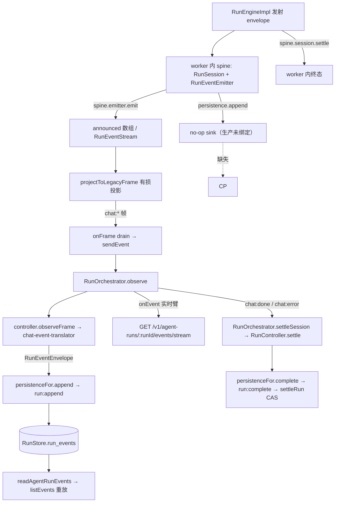

# 17-S0 — 生产事件权威接缝合同

Date: 2026-10-17. Parent: [17 共享 Agent 平台执行计划](./17-shared-agent-platform-execution.md) §5 S0.
Slice: S0（复现 + 冻结权威）. Status: 实施完成，S1 可据此动工。

基线：master `d9561936`，工作树在开工时 CLEAN，Windows 11 / Node v24.16.0 / npm 11.13.0。
本切片唯一改动的源码是测试：`packages/host/tests/worker-product-runtime/engine-turn-harness.ts`
（+12 行，纯 additive）与新增
`packages/host/tests/worker-product-runtime/native-event-authority-loss.test.ts`。
**没有改任何生产代码。**

复现命令：

```bash
npx vitest run packages/host/tests/worker-product-runtime/native-event-authority-loss.test.ts
```

实测结果：8 passed（其中 2 条是 `it.fails` 契约，见 §6）。

---

## 1. 对计划前提的两处更正

S0 的第一项产出是更正，不是确认。计划 §2 有两处与生产实测不符，接手 S1 前必须知道。

### 1.1 `turn.completed` 在生产路径上根本不会被引擎发出

计划 §2 把 `turn.completed` 举为「引擎出现、Host 台账缺失」的样板事件。实测不成立：

```
native: run.started, turn.started, assistant.text_delta, tool.call_started,
        assistant.text_block, tool.call_completed, turn.started,
        assistant.text_delta, assistant.text_block,
        assistant.message_finalized, run.completed
```

全仓 `turn.completed` 的命中只有三类：`legacy-sse-projector.ts:301` 的 `return null`
分支、`surface/legacy-projection.ts:52` 的映射表、以及测试里的合成 envelope。
`packages/agent-runtime/src/engine/run-engine.ts` **没有任何 `turn.completed` 发射点**。

**Why 这条必须在 S0 就钉死：** 计划 §5 S1 的第一条是「新通道传原生 envelope」。如果照
「投影丢了就补齐」去实现，会为一个**没有生产者的事件**建通道，而且验收会写
「`turn.completed` 已贯通」——这条永远通不了。更危险的方向是：拿投影器的 null 列表当
「缺陷清单」，把 11 个事件全部当作「应该有但丢了」，而其中多数同样没有生产者。

复现层 A2 把它钉成可执行事实（`nativeCount(run.native, 'turn.completed') === 0`，
同时断言 `turn.started === 2`，排除「整轮没跑」的平凡解释）。

### 1.2 丢失发生在两个互相独立的接缝，不是一个

计划 §2 分别列了「worker 输出有损」和「spine 未绑定持久化」，但没有说清它们是两个
独立故障、必须分别修。实测：

| 接缝 | 事实 | 后果 |
| --- | --- | --- |
| A. 绑定 | `worker-process-entry.ts:2279` 调 `driveRunWithEngine` **不传 `persistence`**；driver 只在传入时转发（`worker-engine-driver.ts:169`）；spine 退回 no-op sink（`run-event-spine.ts:100-103`） | worker 侧的原生 envelope 只进 `EngineRunOutcome.announced`，而它唯一的用途是 `worker-process-entry.ts:2337` 打一个计数。**worker 路径上不存在任何 `RunPersistence` 实现** |
| B. 通道 | `worker-engine-driver.ts:235` 把原生 envelope 过 `projectToLegacyFrame`；Host 侧 `run-orchestrator.ts:728 observe` → `controller.observeFrame` → `chat-event-translator.ts:222-426` 从**旧帧词汇**反推 envelope | 11 个无旧帧的事件无法从残帧中重建 |

**Why 必须分开：** 只补 A，B 仍然丢弃；只补 B，A 仍然没有落库。复现的控制组（Layer C）
证明了引擎与 spine 都不是瓶颈——绑一个 recording `RunPersistence` 后，同一个真实
driver 立刻交出 `run.started` / `assistant.message_finalized` / `run.completed`，
且身份完好（`runId` / `seq` 均在）。所以 S1 **不许**改引擎或 spine。

实测丢失清单（本次真实两轮 + 一次工具调用）：

- 引擎铸造、无旧帧、Host 收不到：`run.started`（manifest hash + runtime identity）、
  `assistant.message_finalized`（权威 assistant 消息）。二者 `durability: 'durable'`。
- drain 正常收到的：`turn_start` ×2、`status`、`text_delta` ×2、`text` ×2、
  `tool_use`、`tool_result`、`done`。

---

## 2. 完整路径与每一跳的责任人

这是 S0 要求「点名每处 runId/seq/epoch、manifest、terminal 的创建与提交者」的答案。
`→` 表示数据流向，`[R]` 表示执行事实的产生者，`[C]` 表示控制平面记录的写入者。



| 跳 | 组件 | runId / seq / epoch 谁创建 | terminal 谁提交 |
| --- | --- | --- | --- |
| 引擎 → spine | `run-engine.ts` → `RunEventEmitter` | 引擎铸 `seq`；spine 的 `RunSession` 铸 `runId` 归属 | 引擎只 `proposeTerminal`（记录，不结算） |
| spine → 落库 | `run-event-spine.ts:94-104` | — | **今天无人**（no-op persistence） |
| spine → 旧帧 | `legacy-sse-projector.ts` | seq / runId 在此**被丢弃** | — |
| 旧帧 → Host | `run-orchestrator.ts:728` → `chat-event-translator.ts:222` | Host **重新铸** seq（第二次身份） | — |
| Host → 落库 | `run-orchestrator.ts:290-337` → `run:append` | — | — |
| Host → 终态 | `run-orchestrator.ts:786` → `controller.ts:884` | — | Host 提交 `run:complete` → `RunStore.settleRun` CAS |
| 落库 → 重放 | `run-api.ts:135` → `run-store.ts:495` | 读同一张 `run_events` | — |

生产消费者：Agent Server（`packages/host/src/http-server.ts`）经
`run-execution.ts:147-150` 直连 `RunStore`，SSE 出口 `http-server.ts:2660`，
重放 `http-server.ts:2733`。

**今天的结构性缺陷用一句话说：** 一个 run 的事件身份被铸造了两次（引擎一次，
Host 翻译时一次），权威记录只来自第二次，而第二次的输入是一次有损投影。

---

## 3. 冻结的权威接缝（S1 的施工依据）

以下是 S0 的**唯一权威决定**。S1 照此实现；与之冲突的实现视为违约。

### 3.1 唯一执行事件序列

**一个 run 的执行事件只有一条序列，且只有 Runtime 能铸造它。**

1. `seq` 由 Runtime 侧的 `RunSession` 铸造，per-run 从 1 起严格 +1。
   Host **不得**为执行事件再铸一次 seq；Host 收到的 envelope 必须原样使用其 `seq`。
2. 事件身份 = `(runId, seq)`。**不得**用 `(sessionId, seq)`——session 跨 run，
   两个 run 的 `seq` 会合法重复（`agent-protocol/src/envelope.ts:58-65` 已写明）。
3. session 级游标（客户端重连位置）与 per-run `seq` 是两个标度，**不得**复用同一字段。
4. 缺席即合法：非 durable 事件可以不在 `run_events` 里，于是 `seq` 可以跳号。
   **不得**把「`seq + 1` 连续」当作 durable 完整性的证明；完整性由 receipt + 终态对账保证。
5. `runId` 归属必须校验：Host 收到不属于本 worker / 本 run 的 envelope 时拒绝并记录，
   不接受 payload 自报的身份。

### 3.2 durable 写入与 receipt

1. Runtime 产生的事件**保留其身份**（`runId` / `seq` / `epoch` / 完整 payload）交给 Host。
   **禁止**先投影成旧帧再反推新事件——那是当前实现，也是本切片要消除的东西。
2. Host 校验归属后写入 `run_events`，并返回 **receipt**（`run-receipt.ts`：
   `RunWriteState` / `isDurableWrite`）。`applied` / `reconciled` 算 durable；
   `conflict` / `absent` 不算。
3. 生产启动**必须**有真实 persistence 绑定。空 persistence 只允许显式的测试 /
   无持久化场景；**不得**让权威执行静默使用 no-op sink
   （`run-event-spine.ts:100` 的默认值今天正是这种情况）。
4. 同一事件重复到达不得二次生效：以 `(runId, seq)` 幂等。

### 3.3 终态裁决（今天有两个 writer，这是必须先解开的死结）

实测：**worker 与 Host 都在提交终态。**

- worker 侧：spine 的 `RunSession.settle`（`run-session.ts:558`，落库调用 `:614`）
- Host 侧：`RunOrchestrator.settleSession`（`run-orchestrator.ts:786`）→
  `RunController.settle` → `persistenceFor.complete` → `RunStore.settleRun` 的 CAS

今天由 CAS 决定谁赢，所以结果是**正确但无归属**的：两个 writer 都「宣布」过终态，
`run_events` 里只有一条，且来源不可判定。S1 的裁决规则：

1. **一个 run 只有一个终态 owner。** 选定后写进本文件并作为 S1 的验收项。
2. Host 合成的事实（run 开始、取消升级、worker 崩溃）必须有**明确且无冲突**的
   seq 与终态：它们由 **Host** 铸造，走 §3.1 同一条序列（不是第二条序列），
   并且必须是**最后一个**该 run 的事件。
3. Host 收到「执行已结束」但**尚未落库确认**时，**不得**向客户端发布成功。
   发布成功 = receipt 确认，不是 worker 说了 `done`。
4. 存储拒绝、worker 退出、cancel 与 completion 竞态，都要产生**可对账**的结果，
   不允许出现「一条 `running` 行 + 零线索」（`run-orchestrator.ts:579-585` 已把这条
   列为最坏结局）。
5. `runtime_crash` 只在 Host 未主动请求停止时使用。客户端断连导致的 worker 停止
   是 Host 自己要求的，记 `cancelled`（`run-orchestrator.ts:45-51` 已有此约定，保留）。

### 3.4 旧通道的去向

`chat:*` 帧**只服务旧消费者**（TUI / Desktop 现状）。新通道与旧通道**不得**让同一个
事件被两条路径各自重新 emit 或入账。S1 的 producer / consumer 必须作为一套兼容发布，
不允许只切一半造成半条事件链。

---

## 4. 明确不做的事

- **不改引擎、不改 spine、不改 projector。** 控制组已证明它们不是瓶颈。
- **不新建 `turn.completed` 的生产路径**（§1.1）。若产品确实需要「轮次结束」这个事实，
  那是一次**协议决定**（要么让引擎真的发，要么从协议里退役它），不属于 S1 的接线修复，
  必须单开切片并单独评审。
- 不在本切片做 TUI / Desktop 接线（S2、S6），不建 Web / Bot / Plugin App。
- 不把 legacy 投影重新灌回原生台账（那会让台账的上限变成「UI 恰好显示了什么」）。

---

## 5. 未验证与不支持

诚实标注，避免被当成已验收：

- 复现覆盖的是 **worker 进程内的生产 driver 路径**（`driveRunWithEngine` +
  真实 spine + 真实 `RunEngineImpl` + 真实 worker codec）。它**没有**拉起
  `worker-process-entry.ts` 作为独立进程——该模块 import 时即调用 `main()`，无法被
  测试 import，所以这一层是「用生产同形参数驱动生产 driver」而非进程级 e2e。
- **没有** live provider、**没有**真实 Desktop / Electron、**没有** packaged smoke。
  provider 是脚本化的（只替掉模型远端，不替掉任何被测腿）。
- **没有**验证 `RunStore` 的真实落库：控制组用的是 recording `RunPersistence`，
  它证明「spine 会把这些事件交给一个 sink」，不证明 `run_events` 表能承受它们。
  S1 接线后必须补这一层。
- 崩溃 / 取消 / 存储拒绝路径**未**复现。§3.3 的裁决规则来自源码与既有注释，
  不是本切片的实测结果。
- 并行 session 提示：本文件写作期间共享检出出现了其他 session 的未提交改动
  （`AGENTS.md`、`ARCHITECTURE.md`、`package.json`、series README，以及若干新增
  未跟踪文件）。它们不属于本切片，本切片未触碰。

---

## 6. 交接模板（按 17 §6 填写）

```text
Slice / owner / commit / OS / worktree state:
  S0 / mavis / master d9561936 (未提交) / Windows 11 · Node v24.16.0 ·
  开工时 CLEAN，写作期间出现他方未提交改动

Production caller before -> after:
  before: driveRunWithEngine 被 worker-process-entry.ts:2279 调用，不传 persistence；
          原生 envelope 经 projectToLegacyFrame 降为 chat:* 帧出进程
  after:  未改生产代码（S0 只交付复现 + 合同；§3 是 S1 的施工依据）

Authority and compatibility decisions:
  §1.1 更正：turn.completed 无生产者，不得作为 S1 验收样板
  §3.1 唯一执行事件序列由 Runtime 铸造，Host 不得二次铸 seq
  §3.2 生产必须绑定真实 persistence，空 sink 只允许显式测试场景
  §3.3 终态当前有两个 writer（worker spine + Host settleSession），CAS 决定赢家 →
        S1 必须指定唯一 owner；本切片不替 S1 做这个选择

Changed paths / remaining consumers:
  M packages/host/tests/worker-product-runtime/engine-turn-harness.ts (+12, additive)
  A packages/host/tests/worker-product-runtime/native-event-authority-loss.test.ts
  生产代码零改动；harness 的其余 8 个使用方不受影响（新增可选字段，未传即保持原行为）

Failing reproduction -> passing evidence:
  复现 8 passed。2 条 it.fails 契约是**故意红**的合同：
    - 「引擎铸造的每条 durable 事件都到达 Host 台账」今天失败
    - 「生产形状的 run 恰好提交一次终态」今天失败
  非空洞性已验证：移除契约断言体后 `it.fails` 转红（1 failed / 7 passed），
  证明它是真断言而非恒过的壳；恢复后 8/8 绿。

Targeted tests / typecheck / gates / real UI or terminal:
  npx vitest run <the file>  → 8 passed
  npm run typecheck:all      → exit 0
  npm run architecture:check → exit 0，2686/2686 tolerated，baseline 932 未动
  无真实 UI / PTY 验证（本切片不涉及 UI）

  同目录 11 个套件一起跑：8 passed / 3 failed（7 条）。**已按 (file, test, signature)
  归属为既有失败，非本切片引入**，两轮独立证据：
   1) 只跑那 3 个套件（不含本切片新文件）→ 同样 7 条红；
   2) `git stash push` 仅撤掉 harness 的 12 行 → 仍然同样 7 条红，签名逐字相同。
  涉及 live-ring-refresh-frame ×1、run-lifecycle-seam ×4、turn-assembly-seam ×2。
  处置留给它们的 owner，本切片未触碰其断言。

Persistence and rollback limits:
  仅测试文件；回滚 = 删新文件 + 还原 harness 的 12 行。
  未触碰 run_events schema，未产生任何数据或外部副作用。

Unverified or unsupported:
  见 §5（进程级 worker e2e、真实 RunStore 落库、崩溃/取消/存储拒绝路径均未验证）

Next executable task:
  S1 —— 按 §3 实现原生事件到 Host 的权威链路；先补「真实 RunStore 落库」这一层
  （§5 缺口），再动通道；producer/consumer 兼容发布。
```
