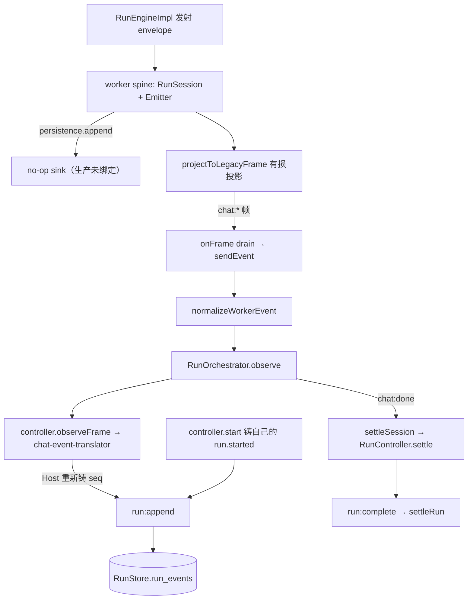

# 17-S0 — 生产事件权威接缝合同（第二版）

Date: 2026-10-17（修订同日）. Parent: [17 共享 Agent 平台执行计划](./17-shared-agent-platform-execution.md) §5 S0.
Slice: S0（复现 + 冻结权威）. Status: **partial — 见 §7 未闭合项**.

基线：master `9c8d589a`（第一版 S0 提交），Windows 11 / Node v24.16.0。
本切片仍然**零生产代码改动**。

复现命令：

```bash
npx vitest run packages/host/tests/worker-product-runtime/native-event-ledger-roundtrip.test.ts \
                packages/host/tests/worker-product-runtime/native-event-authority-loss.test.ts
```

实测结果：12 passed（其中 2 条是 `it.fails` 的 S1 门禁，见 §5）。

---

## 1. 三处更正：第一版有三处结论是错的

第一版的复现停在 driver 局部输出上就下了全链路结论。审查指出后重做，实测推翻了其中三条。
**写下来是为了让 S1 不再从这三条出发。**

### 1.1 `turn.completed` 没有生产者（第一版已记，仍然成立）

`run-engine.ts` 没有任何 `turn.completed` 发射点；全仓命中只有投影器 null 分支、
surface 映射表、测试合成 envelope。真实运行实测该事件计数为 0。

### 1.2 台账不是「事件缺失」，而是「身份被重建」（推翻第一版的核心结论）

第一版称 `run.started` / `assistant.message_finalized` 从未进入 Host 台账。**不成立。**
真实 `run_events` 实测（`native-event-ledger-roundtrip.test.ts`）：

| Runtime 铸造（worker） | Host 台账实际存储 | 判定 |
| --- | --- | --- |
| `run.started#1` | `run.started#1` | 存在，但是 **Host 自己铸的**（`controller.ts:526-543`，派发前发射并落库） |
| `turn.started#2` | `turn.started#2` | 存在，seq 恰好相同 |
| `assistant.text_delta#3` | — | 未持久化（ephemeral，按设计） |
| `tool.call_started#4` | `tool.call_started#**5**` | **seq 不同 → 重建** |
| `assistant.text_block#5` | `assistant.text_block#**6**` | seq 不同 → 重建 |
| `tool.call_completed#6` | `tool.call_completed#**7**` | seq 不同 → 重建 |
| `turn.started#7` | `turn.started#8` | seq 不同 → 重建 |
| `assistant.text_delta#8` | — | 未持久化（ephemeral） |
| `assistant.text_block#9` | `assistant.text_block#**11**` | seq 不同 → 重建 |
| `assistant.message_finalized#10` | — | **完全没有对应行** |
| `run.completed#11` | `run.completed#**12**` | seq 不同 → 重建 |

台账里共 8 行，`run_metrics` 记 `eventsTotal:12 / eventsDurable:8`。

**Why 这比「缺失」更准确：** 台账里绝大部分事实都在，缺的是 **Runtime 的身份**。
Host 在翻译旧帧时重新铸 `seq`，所以任何一行都无法对回引擎真正发出的那个 envelope。
两个序列的偏移量恰好等于被跳过的 ephemeral 事件数——这是「重建」的直接指纹。
S1 若按第一版去「补齐缺失事件」，会做很多工作却碰不到真正的问题。

### 1.3 没有两个持久化 writer，也不存在 CAS 竞争（推翻第一版的终态叙述）

第一版写「worker 的 spine 与 Host 各提交一次终态，由 `RunStore.settleRun` 的 CAS 决胜」。
**这是把一个不存在的竞争当成了架构事实。**

- 生产里直接调 `appendEvents` / `settleRun` 的调用点**全部在测试里**；
  生产写入一律走 `run:append` / `run:complete` → 控制平面 → `RunStore`。
- worker 侧 spine 的 persistence 是 no-op（`run-event-spine.ts:100-103`），
  所以 worker 的终态**从不进入** `run_events`，两个 writer 从未在同一个 CAS 上相遇。

实测：`settleStates = ['applied']`，`runs.status = 'completed'`，`terminal = 'completed'`，
`finished_at` 已写。**Host 已经是唯一的持久化终态提交者。**

这条把 §4 的决定从「待选」变成了「已被证据锁定」。

### 1.4 外层补偿存在，且第一版没看见

- `worker-process-entry.ts:2433-2438`：worker 在 journal flush 后**自己构造**
  `chat:message_finalized` 帧。完整生产链路里这条补偿存在。
- `controller.ts:526-543`：Host 在派发前铸造并落库自己的 `run.started`。

所以必须按三类分别记录，合并成「丢失」一个数字会让 S1 修错东西：

| 类别 | 含义 | 修法 |
| --- | --- | --- |
| **absent** | 台账里没有任何对应行 | 原生通道 |
| **rebuilt** | 事实存在，但身份由 Host 铸造 | 原生通道（让 Runtime 的 seq 直接落库） |
| **compensated** | 外层重建成功，业务事实没丢 | **不是缺陷**；是今天唯一让输出正确的原因 |

实测归属：`assistant.message_finalized` 在 **driver+Host** 这一对里是 absent；
完整生产链路里 worker 补偿会把它变成 compensated。`turn.started` 及其余执行事件是 rebuilt。
`text_delta` 是 ephemeral，不属于任何一类。

---

## 2. 完整路径与每一跳的责任人

`[R]` 执行事实的产生者，`[C]` 控制平面记录的写入者。



| 跳 | runId / seq 谁铸 | terminal 谁提交 |
| --- | --- | --- |
| 引擎 → worker spine | **Runtime 铸 seq**（每 run 从 1 起） | 引擎只 `proposeTerminal`，不结算 |
| worker spine → 落库 | — | **无**（no-op sink，worker 的终态不可见） |
| spine → 旧帧 | seq / runId 在投影中丢弃 | — |
| 旧帧 → Host | **Host 重新铸 seq**（第二次身份） | — |
| Host `controller.start` | Host 铸 `run.started#1` | — |
| Host → 落库 | — | **Host，恰好一次** |

生产消费者：Agent Server `http-server.ts:2660`（SSE）、`run-api.ts:135` → `listEvents`（重放）。

---

## 3. 复现方法的自我修正（留给下一位 agent）

第一版的复现有三个方法缺陷，都会让结论不可靠，逐条记录：

1. **从局部输出推断全链路。** 只看 driver 的 `announced` 和 `frames` 就断言 Host 台账状态。
   必须真的把帧喂进 Host 并**读回 `run_events` 表**。
2. **跳过 router 的规范化。** 生产链路是 `normalizeWorkerEvent(frame)` → `observe(...)`。
   直接把原始帧喂 `observe` 测的是测试的捷径。
3. **写完立刻读。** `observe` 触发的 append 是异步 flush；不 `await settleSession` 就读表，
   得到的「什么都没落库」是**没刷完**，不是没写。同理，**过早 `db.close()` 会让 flush 报
   "The database connection is not open"，读回来是一条事件都没有** —— 这个假象一度让我
   以为整条链路全丢。

另外两个真实 API 形状陷阱（都会静默失败）：

- `run:append` 的回执**必须带写入条数**：`readRunReceipt` 对缺 `written` 的 `applied`
  判定为 `unreadable`，reason 是 `run:append claimed applied without a written count`。
  报的是「没有落库」，不是「落库失败」——方向相反，极易误导。
- `RunOpenOutcome` 用 `state`（`created` / `reused` / `conflict`），没有 `created` 布尔字段；
  `RunEventRow` 用 `event_type` / `run_id` / `envelope_json`，不是 `payload` / `runId`。

---

## 4. 冻结的权威接缝（S1 的施工依据）

### 4.1 权威划分（已由证据锁定，不是待选）

1. **Runtime 产生执行事实**：模型/工具/轮次的事实由 Runtime 铸造，并携带自己的
   `runId` / `seq` / `epoch` / 完整 payload。
2. **Host 是唯一的持久化终态提交者**。证据：worker 的 persistence 是 no-op，
   全部生产写入经 `run:append` / `run:complete`，实测恰好一次 `applied`。
   S1 **不得**引入第二个持久化终态 writer。
3. **Host 合成事实的规则**：Host 合成的事件（run 开启、取消升级、worker 崩溃）走
   §4.2 同一条序列，由 Host 铸 seq，且必须是该 run 的**最后一个**事件。
   **取消升级不是新事件序列**：它是同一序列上、终态之前的最后一个事件；
   「必须是最后一个」指的是**终态事件**，不是所有 Host 合成事件。

### 4.2 唯一执行事件序列

1. 一个 run 只有一条执行事件序列。`seq` 由 Runtime 铸，per-run 从 1 起严格 +1。
2. Host **不得**为转发来的执行事件重铸 `seq`，也不得在翻译阶段分配新身份。
3. 身份 = `(runId, seq)`。**不得**用 `(sessionId, seq)`——session 跨 run，
   两个 run 的 `seq` 会合法重复（`envelope.ts:58-65` 已写明）。
4. session 级游标与 per-run `seq` 是两个标度，**不得**复用同一字段。
5. 缺席即合法：非 durable 事件可以不在台账里，`seq` 因此可以跳号。
   **不得**把「`seq + 1` 连续」当作 durable 完整性的证明。
6. Host 收到不属于本 worker / 本 run 的 envelope 时拒绝并记录，不接受 payload 自报身份。

### 4.3 worker 崩溃 / attempt 失效（第一版缺失，S0 在此定案）

worker 崩溃时 Host 必须能收敛出唯一可对账结果，规则如下：

1. **撤销旧 attempt 的写权限。** 每个 run 的 attempt 带 `epoch`。新 attempt 开启前，
   Host 先把旧 `epoch` 标记为失效；此后携带旧 `epoch` 的迟到 envelope 一律拒绝，
   不得写入、不得改变已提交终态。
2. **确认序列边界。** 崩溃后 Host 读回台账中该 run 已提交的最大 `seq`，作为新 attempt 的
   起点；**不得**假设连续，也不得从 1 重来。
3. **合成终态。** Host 在确认边界后合成该 run 的终态事件（`runtime_crash`），
   并按 §4.2 铸为序列最后一个事件，随后按 §4.1 提交。
   **前置条件**：新 attempt 的权限已在 (1) 中撤销，否则会出现两个 writer 竞争同一 CAS ——
   这正是第一版误以为存在、而生产中实际不存在的那种竞争，不得把它引入进来。
4. **对账而非重做。** 重启先对账已提交结果，不盲目重做外部副作用；
   execution resume 未支持时继续明确拒绝。
5. `runtime_crash` 只在 Host **未**主动请求停止时使用。客户端断连导致的 worker 停止
   记 `cancelled`（`run-orchestrator.ts:45-51` 已有此约定，保留）。

### 4.4 durable 写入与 receipt

1. 原生事件**保留其身份**交给 Host。**禁止**先投影成旧帧再反推新事件。
2. Host 校验归属后写入 `run_events` 并返回 receipt；`applied` / `reconciled` 算 durable。
3. 生产启动**必须**有真实 persistence 绑定；空 sink 只允许显式的测试 / 无持久化场景。
4. 同一 `(runId, seq)` 重复到达不得二次生效；以 `(runId, seq)` 幂等。

### 4.5 旧通道的去向

`chat:*` 帧只服务旧消费者。新旧通道**不得**让同一事件被两条路径各自 emit 或入账。
S1 的 producer / consumer 必须作为一套兼容发布，不允许只切一半。

---

## 5. S1 门禁（打在真实台账上）

`native-event-ledger-roundtrip.test.ts` 末尾两条 `it.fails` 是 S1 的验收门禁。
它们读的是**真实 `run_events` 表**，不是投影函数、也不是一个没被传给被测对象的 recorder：

- `CONTRACT (S1): the ledger preserves the event identity the Runtime minted`
  —— 每条 durable 原生事件都能以 Runtime 自己的身份在台账里找到。
  今天失败（Host 重铸 seq），S1 修好后自然转绿。
- `CONTRACT (S1): no durable Runtime event is missing from the ledger`
  —— `assistant.message_finalized` 今天在 driver+Host 这一对里没有任何行。

非空洞性已验证：移除任一断言体后 `it.fails` 转红（`1 failed`），证明是真断言。

`it.fails` 的语义在这里是**缺陷登记**，不是「合同已成立」：内层断言今天必须失败，
S1 修好后不再抛，`it.fails` 转红，提示删掉 wrapper。删除 wrapper 本身就是 S1 的收尾动作。

---

## 6. 明确不做的事（已放宽第一版）

第一版写「不改引擎、不改 spine」。**该限制过度，收回。** recording sink 能收到事件，
只证明正常绑定路径可工作，并不证明生产启动校验、提交确认和故障处理都无需改动 ——
尤其要禁止静默 no-op persistence，这几乎必然要动 spine 的构造边界。

改为：**保持执行语义，允许为权威绑定、receipt 与终态交接修改必要接缝。**
即：不得改变模型→工具→结果的执行语义；但 `RunSession` / `RunEventEmitter` /
`driveRunWithEngine` / `run-event-spine` 的**构造与绑定边界**可以改。
真正禁止的是 §4.2 的身份规则和「一个终态 owner」。

其余仍然不做：

- 不新建 `turn.completed` 的生产路径（§1.1）。它应登记为**另一项生命周期缺口**，
  而不是用「必须为零」的测试把它固化成正确。
- 不在本切片做 TUI / Desktop / Web / Bot / Plugin App 接线。
- 不把 legacy 投影重新灌回原生台账。

---

## 7. 未验证与未闭合（partial 的原因）

| 项 | 状态 |
| --- | --- |
| `worker-process-entry.ts` 作为**独立进程**的边界 | **未覆盖**。该模块 import 时调用 `main()`，无法被测试 import。本切片覆盖到 driver + Host + 真实台账，**worker 进程边界仍未验证** |
| worker 的 `chat:message_finalized` 补偿在真实链路中的效果 | **未验证**。§1.4 的结论来自读源码，不是实测。`absent` 与 `compensated` 的分界因此只有 driver+Host 一侧的证据 |
| 崩溃 / attempt 撤销 / 存储拒绝 / 取消竞态 | **未复现**。§4.3 的规则来自源码与既有注释，**不是实测结果** |
| live provider、真实 Electron、打包 smoke | 未做（本切片不涉及 UI） |
| 完整 610 验收 | 未做 |

并行的 heisenbug：`worker-product-runtime` 同目录另有 **7 条既有红**
（live-ring-refresh-frame ×1、run-lifecycle-seam ×4、turn-assembly-seam ×2）。
已按 `(file, test, signature)` 两轮证伪为既有失败（单独跑同样红；撤掉本切片改动后同样红、
签名逐字相同），非本切片引入，处置留给它们的 owner。

共享检出提示：写作期间有其他 session 的未提交改动，本切片全程只动自己那两个测试文件。

---

## 8. 下一步（很窄）

1. **先定 attempt/epoch 的持久化形状**：§4.3(1) 需要一个能被 Host 拒绝的 attempt 身份，
   `RunStore` 目前只有 `(run_id, seq)`，没有 epoch 列。这是 additive 迁移 + 旧 reader 兼容。
2. **再补 §7 表格第一行的缺口**：worker 进程边界要么用真实 e2e 覆盖，要么在计划里
   明确记为永久不可测，不能默认略过。
3. **然后才动通道**：按 §4.2 让 Runtime 的 envelope 原样进台账，
   producer/consumer 兼容发布，并删掉两条 `it.fails` wrapper。
4. **不要**在上述之前改 UI / 建新包 / 重写 Rust。
