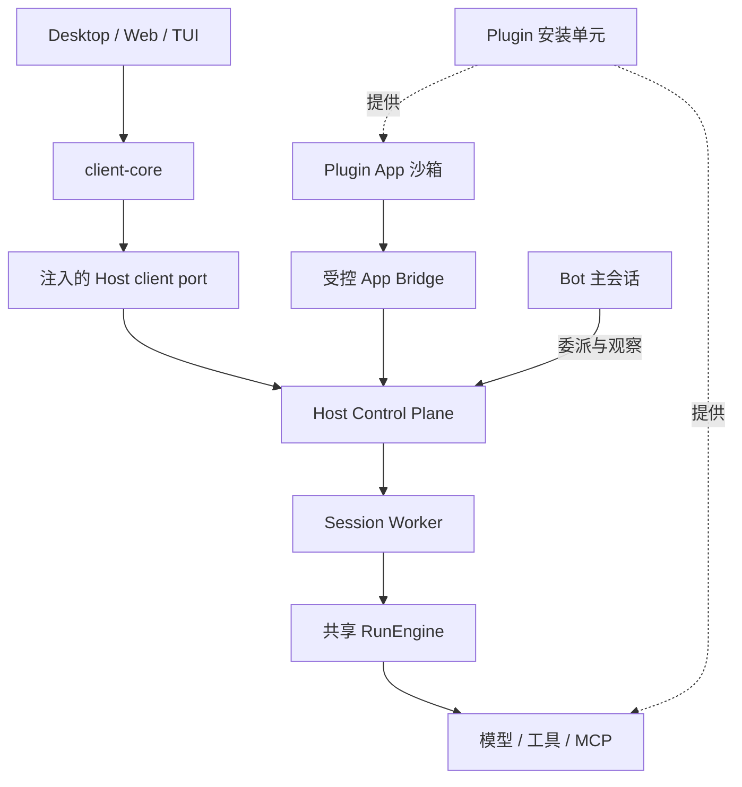

# 17 — 共享 Agent 平台：事件、客户端、Bot 与 Plugin App 执行计划

Date: 2026-10-17. Parent: [610](README.md). Status: Ready for implementation.

> ⚠️ **执行队列已移到 [19 — 快速执行队列](./19-fast-track-queue.md)（2026-10-17）。**
> 本文仍是**架构裁决的准据**（职责边界、Rust 取舍、唯一执行事件序列、不能混淆的概念）。
> 但 §5 的切片状态表**已过期**：S0 已收口、S1 基本落地（`15fa4850` / `cdee21d5` /
> `a935741f` / `ac1f5183`），而本文仍把它们标成 `Ready` / `Waiting`。
> **排期、下一张卡、验收命令只在 19 里回答。**

本文件交付分析和实施队列，**没有把计划中的运行时修复记成完成**。
用户要求直接写入当前工作区，由后续 agent 实施；本轮不改生产代码。

## 0. 结论与第一项任务

目标架构成立：一个 RunEngine，Host 管控制平面，客户端共享状态投影；Bot 使用同一引擎，
通过 Host 调度多个 session；Plugin 可以同时提供 MCP server 和嵌入 Duya 的应用。

**当前首要阻塞是生产事件链路有损，不是缺少一个新 package。**
先让 Runtime 原生事件完整进入 Host 的权威台账，再接 TUI 和 Desktop。
否则客户端接上 `SurfaceModel` 后，仍收不到上游已经丢失的轮次、权限等生命周期事实。

**第一位执行 agent 只领取 S0：复现原生事件在 worker → Host 途中的丢失，
冻结事件身份、持久化和终态的唯一权威接缝，随后实施 S1。**
不要从搬 UI、重写 Rust、另建 client 包或删除旧 Agent 开始。

## 1. 与既有计划的关系

- 本文件是 610 的后续执行切片，不另开一套架构计划。继承 587/610 的分层、权限、数据与验收合同。
- 本次用户授权扩大后续范围到共享客户端、Bot、Plugin App、Web 与远程访问。
  [12 退役协同](12-agent-retirement-coordination.md) 中“不建新客户端”等限制继续约束其退役切片，
  不应误读为这些产品目标永久取消，也不应把它们混入一个退役 PR。
- [15 A8](15-slice-a8-client-core.md) 的已完成平移保留。
  本文件调整其后续顺序：原生事件接线先于 TUI；有第二个真实 React 消费者后才抽共享 UI。
  §6 的“先搬 A 类 UI”不再作为本次实施入口。
- [16 UI 普查](16-a8-ui-census.md) 保留测量价值；其历史数字及抽取建议不是当前可执行验收。
- [611 TUI foundation](../611-tui-foundation-slice.md) 的 admission、composer、终端生命周期继续保留，
  本轮先替换投影边界背后的状态来源，不重做已存在的交互框架。
- 实施前查看在途 worktree/PR，尤其 retirement、recovery、browser-runnable gate。
  已有实现先复核和接续，不按本文文件名另写一份重复实现。
- 若具体实现需要修改既有合同，应在同一切片明确修订受影响合同和测试；本文不隐式推翻安全或依赖禁令。

## 2. 当前证据与置信边界

审计发生于 2026-10-17，主要源码快照为 `a35bc322`；写计划期间又观察到 `c61eed43`。
共享检出存在其他任务的未提交改动。以下是该次审计证据，**不代表未来 checkout 的基线**。
后续 agent 必须记录自己实际使用的 commit、工作树状态、OS 和构建状态。

| 发现 | 源码入口 | 判断 |
| --- | --- | --- |
| 真实 worker 调用共享引擎 | `packages/host/src/worker-process-entry.ts` → `worker-engine-driver.ts` → `run-engine-execution.ts` → `packages/agent-runtime/src/engine/run-engine.ts` | 已接生产；模型 → 工具 → 结果 → 下一轮由 RunEngine 驱动 |
| SurfaceModel 已搬家 | `packages/client-core/src/surface/surface-model.ts`；Runtime barrel 为过渡导出 | 已完成；不再重复搬到 protocol |
| worker 输出有损 | `worker-engine-driver.ts` 的 `onEnvelope` 调用 `projectToLegacyFrame`；`packages/agent-runtime/src/project/legacy-sse-projector.ts` 对 `turn.completed`、`tool.timed_out` 等返回 null | 明确的语义缺口；S0 补生产链路复现 |
| 原生 spine 未绑定生产持久化 | worker 调用 driver 未传 `persistence`；`packages/host/src/run-event-spine.ts` 默认空 append/complete | worker 内部提交不等于 Host durable receipt；不能据此声称完全没有落库，外层仍有写入 |
| Host 从旧帧重建事件 | `packages/host/src/run-orchestrator.ts: observe` → `packages/agent-runtime/src/controller.ts: observeFrame` → translate/emit | 原生身份与 Host 台账尚未贯通；存在两处生命周期装配 |
| 正式 TUI 仍走旧投影 | `packages/cli/src/chat.ts: runTurn` → `tui/host-event-stream.ts` → `TUIApp.ts` 的 TranscriptModel | client-core 尚未成为正式 TUI 状态来源 |
| Desktop 独立维护流状态 | `apps/desktop/src/renderer/lib/stream-session-manager.ts` | 仍有独立的回调、store 与 Electron 耦合 |
| 能力契约有基础 | protocol 的 `version.ts`、`capabilities.ts`、`host-capabilities.ts`；core 的 `capability-negotiation.ts` | 不应写成“客户端消费声明完全不存在”；缺少实际绑定及降级闭环 |
| Bot 有真实管理工具 | `packages/host/src/worker-tools/bot-builtin.ts`、`worker-tool-services/session-management.ts` | 已有能力基础，不从零另造 Bot 引擎 |
| 子 session 管理仍依赖 Desktop | `apps/desktop/src/main/agents/db-bridge.ts` 的 `session:spawn*`；独立 Host `worker-db-bridge.ts` 无对应分支 | standalone 会落到 unimplemented_domain，尚未跨宿主闭合 |
| Plugin 与 Widget 未连成应用平台 | Desktop plugin manifest、`WidgetRenderer.tsx`、`packages/capabilities/src/widget-tool.ts` | 有 MCP、UI 元数据和聊天 Widget；未找到完整可安装 App 生命周期 |
| Web 尚未出现 | `apps/web` 不存在；G10 报 absent entry | browser-safe 扫描通过不能证明浏览器应用可运行 |
| 旧包仍不能删除 | `scripts/architecture/agent-retirement-gate.mjs` | 审计时 OPEN；235 blocking 命中跨生产/构建/配置/测试，不是 235 个生产调用 |

同次审计的验证：

- `architecture:check`：2678 tolerated、无新增；不是“架构债归零”。
- G10：0/864 个第一方闭包文件触及 Node 内建；不覆盖所有第三方打包行为及 Electron 全局调用。
- 9 文件 / 161 测试通过：client-core 模型、Host 能力、replay cursor、TUI 事件与接线、
  Host run execution、translator/projector、surface conformance、engine spine/surface。
- Host execution 含 stub worker，engine 用例含离线模型；未建立 live provider、真实 Desktop 或打包验收。
- 本次架构审计未运行全量测试、全量 typecheck；既有全仓失败按测试身份和错误签名比较，不能按总数抵消。
- 引用聊天中的助手回复读取为内容占位符；本文依据用户明确写出的修订与源码，
  不把不可读取的“最终助手方案”当作已核实合同。

## 3. Rust 是否值得：按职责决定

### 3.1 本轮建议

**技术上可以用 Rust 实现中间层，但目前不值得整体重写。** 当前没有 profiling 证明这些包的
CPU、内存或启动耗时是主要瓶颈；已经确认的事件丢失、双重身份和 Desktop 归属问题，换语言仍然存在。
TypeScript → Rust 本身不提供事件完整性、任务恢复或权限正确性。

| 层/模块 | 当前选择 | Rust 的适用条件与成本 |
| --- | --- | --- |
| agent-protocol | 保留 TS 契约和现有运行时校验 | 如将来出现 Rust 消费者，补统一 schema/fixture 或生成绑定；不能手写两套字段、错误码与版本规则 |
| client-core / SurfaceModel | 保留 TS | WASM 可实现纯 reducer，但当前状态对象、字符串增量和订阅都在 JS 侧；需要额外绑定、数据转换、加载与测试，收益未测 |
| client-react / 纯展示 UI | 保留 TS/React | 绑定 React 和 DOM 的层迁 Rust 不消除 JS 桥接；不为它引入第二个 UI 框架 |
| client-node / HTTP client | 保留 TS，先复用现有实现 | 文件发现和网络适配尚无性能证据；如果只剩一个消费者，暂留 CLI，避免无效抽包 |
| RunEngine / Agent Core | 本轮保留 TS | 重写会同时触及 provider、tools、hooks、compaction、权限与持久化一致性；需要完整行为等价与跨语言测试，不应与当前接线迁移混做 |
| Host 服务 / Bot 调度 | 本轮保留 TS，接口允许未来替换 | 长驻 daemon、资源预算或 OS 集成若成为实测瓶颈，可评估 Rust；不能因此复制一套控制平面或数据库 owner |
| 索引、解析、批量计算等独立热点 | 优先候选 | 输入输出清楚、可批处理、CPU/内存热点明确，并有 TS 参考结果时值得试点 |
| 平台进程/PTY/沙箱辅助模块 | 按实际需求评估 | Rust 可以作为独立辅助进程或 native 模块；需验证目标 OS、打包、取消、崩溃和升级行为，不自动扩大成桌面框架迁移 |

包边界首先应表达职责。为了“以后可能用 Rust”，现在就把全部调用改成 RPC，也会制造成本。
可跨进程的服务保留版本化 DTO；同进程纯逻辑继续用普通接口。

### 3.2 未来引入 Rust 的门槛

Rust 试点是可选后续，不阻塞 S0–S9；本次不承诺实施任何 Rust 包。

1. 先记录用户可见问题和 profiling：耗时分布、CPU、峰值内存、启动时间、输入规模。
2. 选一个有真实消费者的窄模块；预先写清成功标准，先尝试 TS 侧批处理、缓存或算法修复。
3. 比较端到端结果，包含序列化/转换、跨边界调用、启动与包体成本，不能只比较 Rust 内部函数。
4. 使用共同 fixture 验证 Unicode、序号、错误、取消和资源清理；协议数值范围必须跨语言一致。
5. 若采用 sidecar，测试进程退出、协议背压和重启；若采用 Node-API，测试 Node/Electron 加载与产物。
   Node-API 的 ABI 稳定性不等于跨 OS/CPU 的单一二进制，也不消除外部库限制。
6. 若采用 WASM，测试目标浏览器、Node 和实际数据交换；Rust 内存安全不等于插件已具备隔离与授权。
7. 试点成功才替换该实现，保留一个权威实现与明确回退；不长期维护两套不同语义的执行引擎。

技术可行性参考（2026-10-17 查阅，判断与性能收益仍需本仓实测）：
[wasm-bindgen 类型边界](https://wasm-bindgen.github.io/wasm-bindgen/reference/types.html)、
[Node-API 与 ABI 稳定性](https://nodejs.org/download/release/v24.16.0/docs/api/n-api.html)。

## 4. 目标职责与不能混淆的概念



- **Protocol**：数据、身份、版本、错误、能力与重放契约；不包含 UI 状态策略和平台 IO。
- **Runtime**：单次 run 的 model → tool → result → next turn、预算、取消与执行生命周期。
- **Host**：装配/监督 worker，拥有控制平面记录、授权、调度与权威存储；具体执行仍由 Runtime 完成。
  逻辑职责与进程位置分别定义，不能靠改包名证明 owner 已迁移。
- **Client-core**：投影 Host 事实，并维护连接、待提交草稿等客户端交互状态。
  可以产生本地交互状态，不能伪造 Host 已接受、已审批或已完成的业务事实。
- **Bot**：长期身份、主会话、记忆和触发策略；自己的推理也走共享 Runtime。
  Bot 决定要做什么，Host 服务实施持久化调度，不在 renderer 或 Bot 内再造一个执行循环。
- **Plugin App**：有稳定身份和实例生命周期的应用界面；可以由同一 Plugin 提供多个。
  聊天 Widget 是现有呈现能力，不能仅改名就当作可安装 App。
- **Gateway**：现有 `@duya/gateway` 是消息渠道网关。远程认证/Relay 使用独立职责，不能接错包。
- **重放与恢复**：恢复页面状态、恢复调度任务、继续中断执行是三个能力。
  不得因 replay 测试通过就把 execution resume、pause 或 determinism 从 unsupported 改为 supported。

## 5. 实施队列

只领取前置满足的切片。S0 是唯一立即入口；后续状态统一为 Waiting，不意味着要一次做完。
每片一个可审查交付，阶段内可再拆 PR，但不能省略生产消费者和删除条件。

| 切片 | 状态 | 前置 | 交付 |
| --- | --- | --- | --- |
| S0 事件权威复现与合同 | Ready | 阅读在途变更 | 一个生产链路失败用例 + 唯一权威决定 |
| S1 原生事件到 Host | Waiting | S0 | 原生事件、durable receipt、终态贯通 |
| S2 client-core 与正式 TUI | Waiting | S1 | 共享状态实际驱动 TUI |
| S3 能力绑定与边界门禁 | Waiting | S0；生产接线基于 S1 | 能力方向、绑定、授权和降级闭环 |
| S4 独立 Host 与 Bot 调度 | Waiting | S1、S3 | Desktop 外的 session 管理与可靠通知 |
| S5 Plugin App 纵向切片 | Waiting | S1、S3 | 安装、实例、受控调用和持久化 |
| S6 Desktop 共享状态接入 | Waiting | S2、S3 | 逐块替换旧流管理和业务 IPC 形状 |
| S7 最小 Web 与真实 UI 复用 | Waiting | S6；所需 Host API 独立可用 | 第二个 React 消费者，再确定共享 UI 缝隙 |
| S8 Remote Relay | Waiting | S3、S7；注册/认证合同完成 | 授权的远端 runtime 与审批链路 |
| S9 兼容层删除与总验收 | Waiting | 各被删功能有替代消费者和证据 | 旧 Agent/旧投影按消费者归零收尾 |

S4、S5 可在共享接口冻结后分别实施；S9 中旧 Agent 的独立退役工作可继续，不要求等 Remote 才删包。
但不得在 S2 的消费者迁走前删除其唯一 SurfaceModel 消费者。
“最后总验收”不代表允许旧包一直存活到所有新产品功能完成。

### S0 — 先复现，再决定权威接缝

范围：Host worker driver、event spine、RunOrchestrator/Controller 和生产 worker 通道。

- 记录完整路径：引擎 emit → worker 输出 → Host 接收 → durable store → SSE → replay。
  点名每处 runId/seq/epoch、manifest、terminal 的创建与提交者，区分执行事实和控制平面记录。
- 使用真实 worker 入口与受控离线 provider/工具触发多轮，证明 `turn.completed` 等事件能在引擎出现，
  却在 Host 台账缺失。不能只测投影函数返回 null，也不能只用伪造 worker 帧证明集成。
- 冻结接缝：Runtime 产生的执行事件应保留其身份；Host 校验所属 worker/run、持久化并返回 receipt。
  开始、取消升级、worker 崩溃等 Host 侧合成事实必须有明确、无冲突的序列和终态裁决规则。
- 复用既有 emitter、fence、append receipt 和 terminal barrier；若其现有合同不能表达接缝，明确修改点。
  不让 Runtime 和 Host 各自宣称同一个 run 已提交终态。

完成：失败用例在旧路径稳定失败；合同写明唯一执行事件序列、durable 写入和终态裁决责任；S1 可据此实施。

### S1 — 原生事件成为 Host 权威链路输入

- 新通道传原生 envelope，保留必要身份和完整 payload；旧 `chat:*` 只服务旧消费者。
  不能先投影成旧帧再反推新事件；同一事件不能同时由两条路径重新 emit/入账。
- 生产启动要求有真实持久化绑定；空 persistence 只允许显式测试/无持久化场景，不能静默用于权威执行。
- 完成 committed terminal barrier：存储拒绝、worker 退出、cancel 与 completion 竞态都产生可对账结果。
  Host 收到未提交的执行结束不等于可向客户端发布成功。
- 连接 live 与 durable replay；处理慢消费者、断线、分页、重复、外来 run、越界 cursor 和 epoch 拒绝。
  非持久事件缺席可造成合法 seq 跳号，不把 `seq + 1` 当作 durable 完整性的唯一证明。
- 日志由 Host 持有。客户端遇到需要修复的缺口时请求 Host 窗口，收到拒绝时进行明确降级/重新加载。
  session cursor 不复用 per-run seq；不为了将来可能 resume 就随意扩展 envelope。

验收：生产 worker 的必要 durable 事件原样贯通到 Host/SSE/replay；重复不会二次生效；
重放最终业务状态与 live 一致（允许 ephemeral 差异）；存储失败不出现假成功；终态仅一次权威提交。

### S2 — client-core 实际驱动 TUI

- 将身份隔离、去重/重连协调、状态投影和订阅放进 client-core 的窄边界，平台 IO 由注入 port 承担。
  SurfaceModel 的 `apply` 不等于具备 admission；该模型的生命周期必须受外层会话/run 管理约束。
- 正式 `packages/cli/src/chat.ts` 消费原生事件；TranscriptModel 降为共享状态的 view，
  或删除重复 reducer；本地 notice、草稿、已提交用户输入仍可作为明确的 UI 状态存在。
- 不直接搬旧 SurfaceTape 的“先所有 turn、再所有 tool”布局；保留消息/块身份和真实发生顺序。
- 保留 611 队列、取消和终端资源清理。权限 pending/resolved/expired、tool timeout、
  turn completed/retry、subagent/background 状态不得再次被窄投影丢掉。
- 设计稳定 snapshot/revision：SurfaceModel 可变对象不能原样作为 React 的永久同一快照；
  TUI 订阅也不能每个 token 都遍历全部历史。
- `client-node` 仅在至少两个真实消费者需要相同 Host 发现/启动逻辑时抽取。
  抽取前盘点 `host-session.ts` 与正式 `chatTui` 的实际使用，不能只搬一个非正式入口。

验收：正式 TUI 使用 client-core；闭包没有 Runtime 值依赖；重放不重复文本/工具/终态；
跨 run 事件不污染当前状态；真 PTY 验证输入、重连、取消、权限和窄窗口，不以纯模型测试代替。

### S3 — 能力绑定、授权与门禁

- 盘点三组现有声明及 core 中同名 HostCapabilities，区分“执行”“消费”“提供”，
  选择一个明确的协议 owner；不为命名统一把不同方向强行合成一组布尔值。
- 为真实客户端绑定实现消费声明；Host 返回有效提供能力、版本、限制与不支持原因。
  客户端不依赖 runtime 内部的协商实现，不把 agent-core 间接拖进浏览器。
- 校正 owner 模型：用户本机、工作区/runtime、控制平面服务分别指什么。
  `cron/workflow/plugins/vision_models` 不因今天在 Desktop 里就永久标成本机专属；
  `both` 的满足关系必须明确，不能靠名字或严格字符串比较猜测。
- 选择两个真实界面能力贯通绑定和降级，例如本机目录选择与工作区文件读取。
  缺少能力要可见；请求仍经服务端权限校验，advertised capability 不是授权凭据。
- 接续已有 G11-0 在途工作；预算只对同一作用域 ratchet，排除或分类真实本机 affordance。
  115 等历史计数不写死为永久真理，不能把迁移分母减少伪装成耦合消失。
- G11-1 检查客户端入口值导入闭包不含 Runtime，type-only 不误报，walked > 0。
  G11-2 针对同一业务能力的实际协议 owner/生产引用断言；import 计数不能单独证明词汇语义唯一。
  注入错误值依赖、重复业务 DTO 或绕过协商时必须能变红，撤除后恢复。

验收：至少两个客户端声明的不同能力影响真实行为；服务端拒绝越权/无能力调用；
门禁正反变异通过；G10 通过与“可在浏览器运行”分别报告。

### S4 — 独立 Host 与 Bot 长期调度

- 将 Desktop `session:spawn*` 背后的创建、list/get/reply/cancel/rename 收敛为 typed Host 服务，
  Desktop bridge 仅转发。共享 data owner、worker supervision 和 Control Plane 不再依赖 Electron 常驻。
  沿用 610-B2 的独立 Host 进程目标，先列出本切片还依赖 Main 的句柄与生命周期，再逐项迁移。
- Bot 主会话仍使用共享引擎；通过服务创建/观察子 session 与 run，不能以内联调用绕开 Host。
- 分开 botId、sessionId、runId 与委派任务身份；session 可以连续运行，通知不能仅凭 child sessionId
  判断某次任务已完成。返回可追踪的受理记录，持久化父子关系、输入和最终结果引用。
- 复用 mailbox/wake/routine/subagent/workflow 能力，补完成通知的去重、持久化投递与重启对账。
  `setImmediate + Promise.then` 不是持久化调度；新建 job/outbox 前先查已有 store 和在途 recovery 实现。
- 权限、workspace、provider/model 和预算继承有明确规则；调用方身份由可信 worker/session 绑定确定，
  不直接相信 payload 自报 callerId。子任务不能借 Bot 身份扩权。
- 取消按具体任务/run 处理，定义父取消对子任务的影响；防止取消旧任务误杀新 run。
  重启先对账，不盲目重做外部副作用；execution resume 未支持时继续明确拒绝。
- 普通 child run、subagent、workflow 分别记录接入状态，不因迁了一个 SessionTool 就宣称全部闭合。

验收：关闭 Desktop 后，独立 Host 中的 Bot 可启动两个子 session、追问其中一个、取消另一个并收结果；
重启后任务可查询、已提交结果可重投递且不重复应用；权限拒绝、启动失败和 worker 崩溃有明确结果。

### S5 — Plugin App：先做真实纵向闭环

- 为现有 Plugin manifest 增加兼容的 App 声明，明确插件版本、appId、入口、所需能力、
  允许调用的工具及状态 schema 版本；选择扩展位置前核对现有 native/兼容插件格式。
- 分开安装包、App 定义、App 实例和 session/run。一个 Plugin 可以提供多个 App；
  同一 App 可有多个实例，状态不能只存在 React 组件或一条聊天消息里。
- 应用 UI 运行在现有沙箱机制的合适扩展中，复用 Widget 可用部分；不直接给 UI 整个 electronAPI、
  Host bearer 或 MCP 凭据。桥接请求验证来源、实例身份、schema、方法和权限作用域。
- App UI、Bot 和普通 Agent 调用同一服务/工具授权与审计路径；不创建“App 专用免审批执行器”。
  禁用插件、撤销权限、升级或关闭实例后的在途调用有明确行为。
- 做一个示例 Plugin，至少两个 App 入口和两个隔离实例，共用它提供的 MCP 能力。
  先完成一个实际读写/审批场景，再扩 SDK；可用受控本地 fixture 验收，演示数据明确标注。
- Desktop panel 是首个真实容器；接口保持 browser-safe。TUI 提供文本摘要/可打开目标，
  不把无法渲染 App 作为整个 run 失败的理由。

验收：安装 → 打开 App → 经桥接调用 MCP → 审批/结果更新 UI → 重开恢复状态 → 升级/禁用/卸载；
两个 App/实例不串数据，越权方法被拒绝，App 加载失败不破坏聊天；真实 Electron + Playwright 验证。

### S6 — Desktop 逐块接共享客户端

- 把 stream-session-manager 中的事件解释逐块交给 client-core，保留通知、窗口、rAF 等平台适配。
  与流无关的 UI store 不机械搬包；IPC 业务 DTO 与 HTTP 共用，preload 保留薄转发和本机职责。
- React 绑定使用稳定 snapshot/selector；是否独立 `client-react` 由真实消费决定，
  不把展示组件与会话绑定捆成一个必须依赖 client 的 UI 包。
- 覆盖权限、模式/goal/research、mailbox、compaction、usage、subagent/workflow、
  artifact/widget 等既有功能；缺的事件不能靠旧 callbacks 长期补另一份权威状态。
- 冻结同一录制事件输入，在 TUI/Desktop 的共享业务状态上做一致性验收；呈现差异允许存在。

验收：真实 Desktop turn 经共享状态驱动；取消、审批、最终消息和后台任务不退化；
用户草稿/编辑不被重放覆盖；真实 Electron 验证 preload 路径，浏览器 Vite 预览不能替代。

### S7 — 最小 Web 与有消费者的共享 UI

- 建最小 Web：连接独立 Host、选择会话、发送、流式工具、审批、取消、刷新恢复。
  明确部署与认证方式；不以开放本机 bearer 或随意允许跨域替代 Web 接入设计。
- 可先跨目录复用 browser-safe 组件并注入 client ports。建立 bundler/运行验证，
  第三方 Node 依赖、Electron globals、secret 泄露不能由 G10 的第一方扫描代为证明。
- 当 Desktop 与 Web 都实际消费一组组件后，再决定从 conductor/renderer 或 Desktop 提取何种 UI。
  共享展示层不依赖 client-core，React 订阅层单独存在；不做全 renderer 搬家。
- 先有受认证的单 Host Web 使用闭环；跨 NAT 的远端个人电脑由 S8 处理，二者不互相冒充。

验收：普通浏览器可完成含工具与审批的真实流程；刷新能从 Host 恢复；
同会话双客户端不重复启动/审批；缺少本机能力时有明确呈现；Playwright 验证。

### S8 — Remote Relay 与远端审批

- 沿 610 远端合同评审注册模型：runtime 主动出站连接，每节点可撤销身份、心跳和存在状态。
  Relay 只转发被授权请求，不取得任意工作区访问权，也不复制执行引擎。
- 客户端→Host、Host→runtime、Plugin App→Host 分别鉴权；审批绑定对应 run/tool/input/expiry，
  权威时钟与重复提交裁决在服务端，过期或撤销不能因重连变成允许。
- 选择实际需要的 transport；只有真实消费者要求双向流时才扩 adapter。
  微信“小程序客户端”与本计划的“Plugin Mini App”是不同产品，不能混用平台限制或验收。
- 网络断开不等于执行取消；定义 offline、crashed、reconciling、unsupported resume 的呈现和行为。

验收：两节点授权隔离；撤销即时失效；断线重连事件不重复；远程审批允许/拒绝/超时正确；
跨节点 session 不串数据；仍使用同一 Runtime 实现。不得直接拿消息渠道 Gateway 代替 Relay。

### S9 — 兼容层删除与最终验收

- 对每个 shim 标明真实消费者、退出条件、最晚处理切片。特别是 Runtime 的 SurfaceModel re-export、
  旧 CLI SurfaceTape、旧帧解析、Desktop callback 状态和旧 Agent 的 build/assets/selectors。
- 退役 gate 的引用逐项分类，不把历史文档命中当作生产依赖，也不把脚本出口 0 当作状态已 CLOSED。
- CLI、Desktop、Bot、subagent、workflow、eval 都有对应生产入口验收，才删除其旧路径。
  复用既有 retirement 工作；无依赖的切片可以提前关闭，不等待 S8。
- 更新 ARCHITECTURE、610 状态和用户入口；对比完整测试失败集合，按目标 OS 跑 clean CI 和打包 smoke。

验收：被删除路径消费者归零，旧包不在场时构建/运行仍成立；真实用户流程与持久化一致；
unsupported 能力仍关闭；计划逐片有证据，不能因总架构图成立就把所有 checkbox 勾上。

## 6. 实施纪律、回退与交接

1. 领任务时写明切片、源码基线、独占路径、前置与实际生产消费者。共享 protocol、policy、
   build、Host 入口文件由集成负责人协调；本文件不是自动启动多个 agent 的授权。
2. 可并行的是接口冻结后互不改同一 owner 的实现。S1 的 producer/consumer 必须作为一套兼容发布，
   不允许一边先切换造成半条事件链。遇到在途修复先接续，不覆盖别人的未提交工作。
3. 每片先做有意义的失败复现，再修生产路径；测试调用真实接缝，不只断言接口或文档存在。
   新门禁需正反变异和非空扫描证据，不能新增 baseline 指纹吞掉自己引入的边。
4. 状态持久化采用必要的 additive 迁移，记录旧 reader 兼容性。
   feature switch 只切路由，不能绕权限；同一 run 只用一个事件/终态 owner。
   不把 legacy 投影重新灌回原生台账，也不把 git revert 当作数据或外部副作用回滚。
5. 运行 `npm run typecheck:all`、`npm run architecture:check` 和切片测试；
   改 gate/resolver 补 `architecture:self-test`，改 bundle/module/packaging 边界补 `electron:build`。
   已知失败按 `(file, test, signature)` 对比；环境 EPERM/依赖未构建要与产品失败分开。
6. UI 用 Playwright，preload/Main 用真实 Electron，TUI 用真实 PTY；
   fixture、stub worker、真实离线生产链、live provider、packaged smoke 分别报告。
7. Worktree 验证按仓库 setup 脚本建立 workspace overlay，不在共享 junction 上 npm install；
   清理按现有安全工具执行。用户指定的当前工作区文档任务不因此扩成运行时迁移。

交接模板：

```text
Slice / owner / commit / OS / worktree state:
Production caller before -> after:
Authority and compatibility decisions:
Changed paths / remaining consumers:
Failing reproduction -> passing evidence:
Targeted tests / typecheck / gates / real UI or terminal:
Persistence and rollback limits:
Unverified or unsupported:
Next executable task:
```

## 7. 本轮交付与下一步

- [x] 核对共享平台架构与当前生产接线，区分已实现和未验收。
- [x] 记录 Rust 的可行性、收益前提与本轮语言选择。
- [x] 将发现整理为可交接切片，明确消费者、前置和验收。
- [ ] S0 生产事件丢失复现及权威合同。
- [ ] S1 原生事件与持久化链路。
- [ ] S2 正式 TUI 共享状态。
- [ ] S3 能力绑定与边界门禁。
- [ ] S4 独立 Host 与 Bot 调度。
- [ ] S5 Plugin App 闭环。
- [ ] S6 Desktop 接入。
- [ ] S7 Web 与真实 UI 复用。
- [ ] S8 Remote Relay。
- [ ] S9 各兼容层退出与总验收。

给下一位 agent 的任务：阅读本文件和 610 相关合同，核对在途变更，领取 S0；
先用实际 worker 路径复现原生生命周期事件在 Host 台账中缺失，再决定并实现 S1 的权威接缝。
不要把 Rust 试点、UI 搬家或新包目录作为本轮首个交付。
